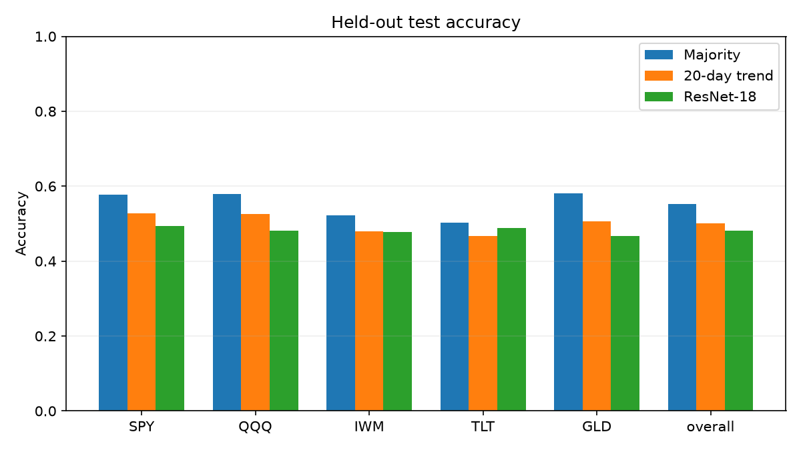

# Financial Chart ResNet

A reproducible study of whether an image classifier extracts information about next-session ETF close direction from a chart of the previous 20 closes. This is an experimental classification project, not a trading system or evidence of profitability.

## Task and data

For each asset separately, use the 20 closes ending at session `t` to draw a 224 × 224 RGB line chart. Label 1 when `Close[t+1] > Close[t]`, otherwise 0. Split by the **label date**: 2010–2021 train, 2022–2023 validation, 2024–2025 test. Assets: SPY, QQQ, IWM, TLT, GLD. Input windows at a split boundary may use earlier known closes; they never use the label-date close in the image. Charts divide by the first close, use a fixed y range 0.8–1.2 and clip outside it; there is no augmentation. Pixels use ImageNet normalization.

Data are daily Yahoo Finance history obtained with [yfinance](https://github.com/ranaroussi/yfinance), `auto_adjust=False`, 2009-01-01 inclusive to 2026-01-01 exclusive. Yahoo's returned `Close` is used, not `Adj Close`; it should not be treated as dividend-adjusted total return. See [Yahoo Terms of Service](https://legal.yahoo.com/us/en/yahoo/terms/otos/index.html), [Yahoo Finance data providers](https://help.yahoo.com/kb/SLN2310.html), and the yfinance disclaimer: yfinance is unaffiliated with Yahoo, intended for research and education, and Yahoo's API is described as intended for personal use. Check the applicable terms before use or distribution. Raw prices are not included in this repository.

Five assets each had 4,276 valid unique observed sessions between 2009-01-02 and 2025-12-31, matching the fixed 2009–2025 calendar in `src/samples.py`. Each yielded 3,021 train, 501 validation and 502 test examples. Per-asset up ratios, clip counts and raw SHA-256 values are in `results/summary.json`. The calendar is explicitly bounded; it is not a general future exchange calendar.

## Protocol

The existing ImageNet-pretrained ResNet-18 classifier-only SPY run was compared with one full-finetune SPY run, each with seed 42, batch 32, Adam and 10 epochs. The full run used backbone lr 1e-5 and classifier lr 1e-3; classifier-only used lr 1e-3 and frozen backbone including BatchNorm statistics. Checkpoints were selected by minimum validation cross entropy. The mode with lower best SPY validation loss was selected for one five-asset pooled run, whose checkpoint was selected by overall validation loss. Ties favor classifier-only and the earliest epoch. The pre-test protocol is recorded in `experiments/research_protocol.json`.

Baselines: (1) constant majority class learned from the relevant training labels, tie to 0; (2) 1 if the last input close is strictly greater than the first, otherwise 0. For the pooled model, the majority is computed once from pooled training labels and applied to all five assets. Precision, recall and F1 refer to class 1; zero denominators yield zero. Confusion matrices use rows = actual [0,1], columns = predicted [0,1]. The selected SPY and pooled checkpoints are evaluated on the same corresponding test samples as the baselines. Validation cross entropy is compared with `ln(2) = 0.693147` for constant p=0.5.

## Results

The classifier-only SPY model was selected: its best validation loss was 0.698535 (epoch 4), compared with 0.733958 (epoch 1) for full fine-tuning. Both were above the constant-probability reference 0.693147. The SPY validation accuracies were 51.30% and 48.70%, respectively; majority and 20-day trend were 49.50% and 50.70%. Full fine-tuning's training loss fell sharply while validation loss increased, consistent with overfitting.

The pooled classifier-only model's minimum overall validation loss was 0.698657 (epoch 9), with 50.06% accuracy, versus 49.90% majority and 50.46% trend. On the held-out five-asset test it achieved **48.17% accuracy**, versus **55.26% majority** and **50.12% trend**. The selected standalone SPY model achieved 51.79%, versus 57.77% majority and 52.79% trend on the same 502 SPY test samples. The model did not beat either baseline on overall test accuracy. These observations do not establish predictability or trading performance.

The complete per-asset validation and test tables, including precision, recall, F1, cross entropy and confusion matrices, are in [results/results.md](results/results.md); raw aggregates and the frozen configuration are in [results/summary.json](results/summary.json). Curves and figures are in `results/`.



## Reproduce in a clean Windows PowerShell environment

The reported run used Python 3.11.4, PyTorch 2.8.0+cu126, torchvision 0.23.0+cu126 and an NVIDIA RTX 4060 Laptop GPU. Other devices or updated Yahoo data can change results; exact replication requires the same source snapshot, software and hardware. The audit JSON includes original hashes so that a fresh download can be checked. PyTorch and torchvision need compatible versions; for the original CUDA 12.6 build:

```powershell
py -3.11 -m venv .venv
.\.venv\Scripts\python.exe -m pip install torch==2.8.0 torchvision==0.23.0 --index-url https://download.pytorch.org/whl/cu126
.\.venv\Scripts\python.exe -m pip install -r requirements.txt
.\.venv\Scripts\python.exe scripts/download_data.py
.\.venv\Scripts\python.exe scripts/build_spy_dataset.py
.\.venv\Scripts\python.exe scripts/evaluate_spy_baselines.py --output data/reports/spy_baselines_d1.json
.\.venv\Scripts\python.exe scripts/check_resnet18_weights.py
.\.venv\Scripts\python.exe -m unittest discover -s tests -v
.\.venv\Scripts\python.exe scripts/train_spy_resnet.py --output experiments/spy_resnet18_d2_seed42
.\.venv\Scripts\python.exe scripts/train_spy_full_finetune.py --output experiments/spy_resnet18_full_finetune_seed42
.\.venv\Scripts\python.exe scripts/build_multi_asset_dataset.py
.\.venv\Scripts\python.exe scripts/train_multi_asset.py
.\.venv\Scripts\python.exe scripts/evaluate_final.py
.\.venv\Scripts\python.exe scripts/summarize_results.py --output results_reproduced
```

The scripts refuse to overwrite pre-existing experiment or dataset outputs. The commands above are for a **clean checkout**, not the original workspace, whose existing experiments must be preserved. Downloading data and pretrained weights requires internet access. The evaluation freezes the protocol, checkpoint hashes and configuration before inference; its output directory must be new. `results/` contains the reported aggregates and charts; local checkpoints and data must be generated separately. If downloading the historical source later produces different hashes, that is a different data snapshot, not an exact replay.

## Limitations

- Overlapping windows and correlated assets make examples dependent; one chronological split and one seed do not establish statistical robustness or reliable future performance.
- Test up ratios were included in the dataset audit before model selection, although test predictions and performance were withheld until the frozen final evaluation. This is not a fully blinded test-label distribution.
- A fixed chart range clips some windows, and a one-pixel line discards other useful information. Results depend on chart and price conventions.
- `Close` with `auto_adjust=False` can reflect ex-dividend effects and is not total return. Accuracy omits transaction costs, execution, uncertainty and risk; none of the reported metrics establish a profitable strategy.
- Yahoo history may be revised or unavailable; data access and redistribution are subject to its terms. The training procedure is seeded, but GPU results are not guaranteed identical across hardware or versions.

Potential future work, outside the reported experiment, includes a fully blinded later period, rolling time validation, multiple seeds and uncertainty estimates that account for temporal and cross-asset dependence. Any trading assessment would require a separately specified, cost-aware protocol.
