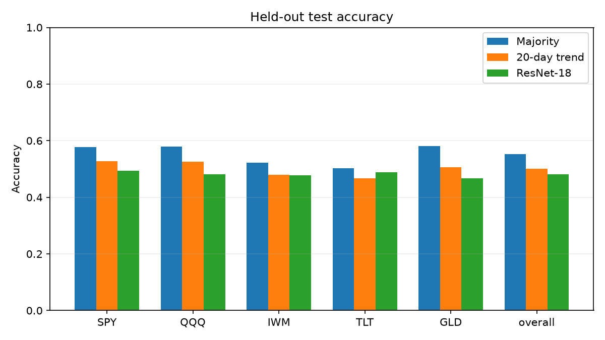

# Financial Chart ResNet

[](https://github.com/aononoismycat-byte/financial-chart-resnet/actions/workflows/ci.yml)
[](LICENSE)


An empirical, leakage-controlled evaluation of whether an ImageNet-pretrained ResNet-18 extracts next-session directional signal from 20-day closing-price line charts across five liquid ETFs (`SPY`, `QQQ`, `IWM`, `TLT`, `GLD`; 2010–2025, 20,120 samples). Designed around pre-registered model selection, chronological splits, cryptographic manifest verification, and explicit baseline benchmarking.

### Key Findings

- **Frozen-backbone transfer resists overfitting better than full fine-tuning**: On `SPY` validation data, freezing the ResNet-18 backbone (`0.6985` cross-entropy) outperformed full fine-tuning (`0.7340`), which rapidly overfit noisy chart images.
- **Line-chart CNNs underperform simple baselines out of sample**: On `2,510` held-out 2024–2025 test windows, the pooled ResNet-18 achieved **48.17%** accuracy, trailing both a 20-day trend rule (**50.12%**) and a constant training-majority baseline (**55.26%**, driven by bull-market upward drift).
- **Direct numeric inputs beat rendered 1-pixel line charts**: A post-hoc `StandardScaler` + logistic regression trained on the exact same 20 normalized closes reached **54.70%** overall test accuracy (`+6.53 pp` over ResNet-18), indicating no added predictive value from rendering univariate closes as 2D line images.

## Task and data

For each asset separately, use the 20 closes ending at session `t` to draw a 224 × 224 RGB line chart. Label 1 means Up (`Close[t+1] > Close[t]`); label 0 means Non-up (`Close[t+1] <= Close[t]`, including decreases and ties). Split by the **label date**: 2010–2021 train, 2022–2023 validation, 2024–2025 test. Assets: SPY, QQQ, IWM, TLT, GLD. Input windows at a split boundary may use earlier known closes; they never use the label-date close in the image. Charts divide by the first close, use a fixed y range 0.8–1.2 and clip outside it; there is no augmentation. Pixels use ImageNet normalization.

Data are daily Yahoo Finance history (`auto_adjust=False`, 2009-01-01 inclusive to 2026-01-01 exclusive) obtained with [yfinance](https://github.com/ranaroussi/yfinance) using unadjusted `Close` prices; raw price files are not distributed in this repository (see [Limitations and disclaimers](#limitations-and-disclaimers)).

Five assets each had 4,276 valid unique observed sessions between 2009-01-02 and 2025-12-31, matching the fixed 2009–2025 calendar in `src/samples.py`. Each yielded 3,021 train, 501 validation and 502 test examples. Per-asset up ratios, clip counts and raw SHA-256 values are in `results/summary.json`. The calendar is explicitly bounded; it is not a general future exchange calendar.

## Protocol

The existing ImageNet-pretrained ResNet-18 classifier-only SPY run was compared with one full-finetune SPY run, each with seed 42, batch 32, Adam and 10 epochs. The full run used backbone lr 1e-5 and classifier lr 1e-3; classifier-only used lr 1e-3 and frozen backbone including BatchNorm statistics. Checkpoints were selected by minimum validation cross entropy. The mode with lower best SPY validation loss was selected for one five-asset pooled run, whose checkpoint was selected by overall validation loss. Ties favor classifier-only and the earliest epoch. The pre-test protocol is recorded in `experiments/research_protocol.json`.

Baselines: (1) constant majority class learned from the relevant training labels, tie to 0; (2) 1 if the last input close is strictly greater than the first, otherwise 0. For the pooled model, the majority is computed once from pooled training labels and applied to all five assets. Precision, recall and F1 refer to class 1; zero denominators yield zero. Confusion matrices use rows = actual [0,1], columns = predicted [0,1]. The selected SPY and pooled checkpoints are evaluated on the same corresponding test samples as the baselines. Validation cross entropy is compared with `ln(2) = 0.693147` for constant p=0.5.

## Results

The classifier-only SPY model was selected: its best validation loss was 0.698535 (epoch 4), compared with 0.733958 (epoch 1) for full fine-tuning. Both were above the constant-probability reference 0.693147. The SPY validation accuracies were 51.30% and 48.70%, respectively; majority and 20-day trend were 49.50% and 50.70%. Full fine-tuning's training loss fell sharply while validation loss increased, consistent with overfitting.

The pooled classifier-only model's minimum overall validation loss was 0.698657 (epoch 9), with 50.06% accuracy, versus 49.90% majority and 50.46% trend. On the held-out five-asset test it achieved **48.17% accuracy**, versus **55.26% majority** and **50.12% trend**. The selected standalone SPY model achieved 51.79%, versus 57.77% majority and 52.79% trend on the same 502 SPY test samples. The model did not beat either baseline on overall test accuracy. These observations do not establish predictability or trading performance.

The complete per-asset validation and test tables, including precision, recall, F1, cross entropy and confusion matrices, are in [results/results.md](results/results.md); raw aggregates and the frozen configuration are in [results/summary.json](results/summary.json). Curves and figures are in `results/`.



## Post-hoc exploratory numeric baseline

After the original ResNet test results were known, we trained one fixed logistic regression on the same 20 closes divided by their first close. A StandardScaler was fit on pooled training data only; C=1.0 was fixed, with no hyperparameter search or validation refit. The script verifies the original raw and manifest hashes and each sample's identity before evaluation. This is a **post-hoc exploratory comparison**, not a fresh confirmatory test.

| Test accuracy | SPY | QQQ | IWM | TLT | GLD | Overall |
|---|---:|---:|---:|---:|---:|---:|
| Logistic regression | 55.78% | 56.77% | 52.39% | 49.60% | 58.96% | 54.70% |
| Pooled ResNet-18 | 49.40% | 48.21% | 47.81% | 48.80% | 46.61% | 48.17% |
| Majority | 57.77% | 57.97% | 52.19% | 50.20% | 58.17% | 55.26% |
| 20-day trend | 52.79% | 52.59% | 48.01% | 46.61% | 50.60% | 50.12% |

The numeric model exceeds the image model and trend baseline overall and on each asset, but falls below the majority baseline overall and on SPY, QQQ and TLT. This comparison does not demonstrate added value from the image representation; it also cannot establish that images never help, generalize beyond these assets or periods, or support a trading strategy. Complete validation and test metrics and matrices are in [numeric_baseline_posthoc.json](results/numeric_baseline_posthoc.json); the fixed protocol is in [numeric_baseline_protocol.json](results/numeric_baseline_protocol.json).

## Prediction demo

After installing dependencies as below, provide a **trained project checkpoint** and a CSV with exactly one `Close` column and 20 finite positive values, oldest first. The user must ensure they are consecutive trading sessions; prices alone cannot verify dates. The included `examples/sample_20_closes.csv` is synthetic, not historical market data, and its output is not an actual financial forecast.

```powershell
.\.venv\Scripts\python.exe scripts/predict.py --input examples/sample_20_closes.csv --checkpoint experiments/multi_asset_resnet18_seed42/best_model.pt
```

The JSON output reports the predicted class (`Up` for label 1 or `Non-up` for label 0, with ties resolved to `Non-up`) along with softmax scores `probability_up` and `probability_non_up` using the exact training chart renderer and ImageNet normalization. Binary checkpoints are excluded from Git tracking: you can either download the pre-trained pooled checkpoint (`multi_asset_resnet18_seed42.pt`, SHA-256 `0e0fb7df7e351b388e64861400d99bd38163927996b784ce6d01000ff5dbab10`) from [GitHub Releases](https://github.com/aononoismycat-byte/financial-chart-resnet/releases) or train one locally via the reproduction pipeline below. ImageNet pretrained weights alone are not a compatible project checkpoint.

## Reproduce in a clean Windows PowerShell environment

The reported run used Python 3.11.4, PyTorch 2.8.0+cu126, torchvision 0.23.0+cu126 and an NVIDIA RTX 4060 Laptop GPU. Other devices or updated Yahoo data can change results; exact replication requires the same source snapshot, software and hardware. The audit JSON includes original hashes so that a fresh download can be checked. PyTorch and torchvision need compatible versions; for the original CUDA 12.6 build:

```powershell
py -3.11 -m venv .venv
.\.venv\Scripts\python.exe -m pip install torch==2.8.0 torchvision==0.23.0 --index-url https://download.pytorch.org/whl/cu126
.\.venv\Scripts\python.exe -m pip install -r requirements.txt
.\.venv\Scripts\python.exe scripts/download_data.py
.\.venv\Scripts\python.exe scripts/build_spy_dataset.py
.\.venv\Scripts\python.exe scripts/evaluate_spy_baselines.py --output data/reports/spy_baselines_d1.json
.\.venv\Scripts\python.exe scripts/check_resnet18_weights.py
.\.venv\Scripts\python.exe -m unittest discover -s tests -v
.\.venv\Scripts\python.exe scripts/train_spy_resnet.py --output experiments/spy_resnet18_d2_seed42
.\.venv\Scripts\python.exe scripts/train_spy_full_finetune.py --output experiments/spy_resnet18_full_finetune_seed42
.\.venv\Scripts\python.exe scripts/build_multi_asset_dataset.py
.\.venv\Scripts\python.exe scripts/train_multi_asset.py
.\.venv\Scripts\python.exe scripts/evaluate_final.py
.\.venv\Scripts\python.exe scripts/summarize_results.py --output results_reproduced
```

The scripts refuse to overwrite pre-existing experiment or dataset outputs. The commands above are for a **clean checkout**, not the original workspace, whose existing experiments must be preserved. Downloading data and pretrained weights requires internet access. The evaluation freezes the protocol, checkpoint hashes and configuration before inference; its output directory must be new. `results/` contains the reported aggregates and charts; local checkpoints and data must be generated separately. If downloading the historical source later produces different hashes, that is a different data snapshot, not an exact replay.

To reproduce the post-hoc numeric experiment after building the five-asset dataset, run:

```powershell
.\.venv\Scripts\python.exe scripts/numeric_baseline_posthoc.py --output results_reproduced/numeric_baseline_posthoc.json
```

This command requires the original source snapshot and exact manifest hashes recorded in `results/summary.json`; it fails instead of comparing different samples if a fresh download has changed. It does not need an image-model checkpoint or retraining, but it does require the original raw files and generated manifest. No full clean-environment replay has yet been performed.

## Limitations and disclaimers

- **Research-only scope**: This repository is an empirical machine-learning study, not financial advice, a trading system, or evidence of live profitability. Softmax outputs are uncalibrated classification scores, and raw accuracy omits transaction costs, slippage, turnover, and risk-adjusted return metrics.
- **Statistical and regime constraints**: Overlapping 20-day windows and cross-asset correlations make observations non-i.i.d.; a single chronological split and single seed (`42`) do not establish statistical significance across market regimes. Test-set class proportions (`55.26%` Up) were recorded in the dataset audit prior to model selection, though test predictions were withheld until the frozen evaluation.
- **Representation and price conventions**: A fixed `[0.8, 1.2]` chart range clips extreme volatility windows, and a 1-pixel close-only line omits OHLC range and volume information. Using `Close` with `auto_adjust=False` reflects ex-dividend drops rather than total return.
- **Data terms and hardware determinism**: Market data are retrieved via [yfinance](https://github.com/ranaroussi/yfinance) (unaffiliated with Yahoo and intended for research/educational use; see [Yahoo Terms of Service](https://legal.yahoo.com/us/en/yahoo/terms/otos/index.html) and [Yahoo Finance data providers](https://help.yahoo.com/kb/SLN2310.html)). Upstream history revisions or GPU/CUDA version differences can alter exact numerical replay.

Planned extensions include transaction-cost-aware backtesting, threshold-independent and calibration metrics (ROC-AUC, balanced accuracy, Brier score), stronger tabular baselines, walk-forward validation, and feature attribution.
