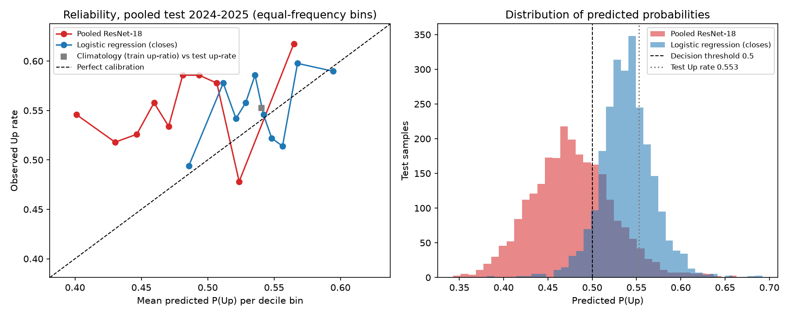

# P1 Stage 1 — Probabilistic evaluation and uncertainty

> Post-hoc exploratory analysis of the frozen 2024–2025 test predictions (protocol: `experiments/p1_protocol.json`). Intervals are 95% circular moving-block bootstrap percentiles over label dates (block 20 sessions, 5000 replicates, all assets on a resampled date kept together).

Climatology reference probability (pooled training up-ratio): **0.5404**. The 20-day trend rule outputs hard 0/1 scores, so its AUC equals balanced accuracy and probability metrics are not meaningful (shown as —).

## Pooled test (2,510 samples)

| Model | Accuracy [95% CI] | Balanced accuracy [95% CI] | ROC-AUC [95% CI] | Brier | Brier skill | Log loss | ECE | Binomial p (acc vs 50%) |
|---|---|---|---|---:|---:|---:|---:|---:|
| Majority / climatology | 55.26% [53.11%, 57.41%] | 50.00% [50.00%, 50.00%] | 0.500 [0.500, 0.500] | 0.2474 | 0.0000 | 0.6879 | 0.0349 | 1.49e-07 |
| 20-day trend | 50.12% [47.97%, 52.19%] | 48.25% [46.18%, 50.30%] | 0.482 [0.462, 0.503] | — | — | — | — | 0.921 |
| Logistic regression (closes) | 54.70% [52.31%, 57.13%] | 50.26% [49.00%, 51.54%] | 0.515 [0.487, 0.543] | 0.2474 | -0.0000 | 0.6879 | 0.0281 | 2.68e-06 |
| Pooled ResNet-18 | 48.17% [46.02%, 50.36%] | 50.30% [48.63%, 52.01%] | 0.516 [0.495, 0.537] | 0.2536 | -0.0251 | 0.7004 | 0.0839 | 0.0693 |

## Per-asset test metrics

| Asset | Up rate | Model | Accuracy | Balanced accuracy [95% CI] | ROC-AUC [95% CI] | Brier skill |
|---|---:|---|---:|---|---|---:|
| SPY | 57.77% | Majority / climatology | 57.77% | 50.00% [50.00%, 50.00%] | 0.500 [0.500, 0.500] | 0.0000 |
| SPY | 57.77% | 20-day trend | 52.79% | 48.61% [44.94%, 52.12%] | 0.486 [0.449, 0.521] | — |
| SPY | 57.77% | Logistic regression (closes) | 55.78% | 48.78% [46.29%, 50.95%] | 0.515 [0.470, 0.563] | -0.0015 |
| SPY | 57.77% | Pooled ResNet-18 | 49.40% | 52.27% [48.26%, 56.47%] | 0.537 [0.491, 0.586] | -0.0235 |
| SPY | 57.77% | SPY ResNet-18 | 51.79% | 49.46% [46.09%, 52.84%] | 0.507 [0.466, 0.550] | -0.0125 |
| QQQ | 57.97% | Majority / climatology | 57.97% | 50.00% [50.00%, 50.00%] | 0.500 [0.500, 0.500] | 0.0000 |
| QQQ | 57.97% | 20-day trend | 52.59% | 48.62% [44.95%, 52.07%] | 0.486 [0.450, 0.521] | — |
| QQQ | 57.97% | Logistic regression (closes) | 56.77% | 50.34% [47.89%, 52.68%] | 0.519 [0.469, 0.573] | -0.0028 |
| QQQ | 57.97% | Pooled ResNet-18 | 48.21% | 50.77% [47.66%, 53.96%] | 0.514 [0.476, 0.556] | -0.0415 |
| IWM | 52.19% | Majority / climatology | 52.19% | 50.00% [50.00%, 50.00%] | 0.500 [0.500, 0.500] | -0.0000 |
| IWM | 52.19% | 20-day trend | 48.01% | 47.39% [43.94%, 50.94%] | 0.474 [0.439, 0.509] | — |
| IWM | 52.19% | Logistic regression (closes) | 52.39% | 50.68% [48.11%, 53.26%] | 0.541 [0.497, 0.585] | 0.0050 |
| IWM | 52.19% | Pooled ResNet-18 | 47.81% | 48.86% [45.54%, 52.39%] | 0.493 [0.444, 0.540] | -0.0175 |
| TLT | 50.20% | Majority / climatology | 50.20% | 50.00% [50.00%, 50.00%] | 0.500 [0.500, 0.500] | -0.0000 |
| TLT | 50.20% | 20-day trend | 46.61% | 46.62% [42.70%, 50.51%] | 0.466 [0.427, 0.505] | — |
| TLT | 50.20% | Logistic regression (closes) | 49.60% | 49.41% [48.20%, 50.63%] | 0.471 [0.429, 0.516] | -0.0063 |
| TLT | 50.20% | Pooled ResNet-18 | 48.80% | 48.88% [45.50%, 52.36%] | 0.512 [0.470, 0.556] | 0.0003 |
| GLD | 58.17% | Majority / climatology | 58.17% | 50.00% [50.00%, 50.00%] | 0.500 [0.500, 0.500] | 0.0000 |
| GLD | 58.17% | 20-day trend | 50.60% | 46.64% [43.17%, 49.75%] | 0.466 [0.432, 0.497] | — |
| GLD | 58.17% | Logistic regression (closes) | 58.96% | 52.56% [49.89%, 55.53%] | 0.534 [0.476, 0.591] | 0.0056 |
| GLD | 58.17% | Pooled ResNet-18 | 46.61% | 50.70% [46.60%, 54.76%] | 0.527 [0.476, 0.581] | -0.0441 |

## Paired differences on the pooled test (A − B)

Positive differences favour A for accuracy, balanced accuracy and AUC; negative differences favour A for Brier and log loss. Bootstrap p is a two-sided sign p-value from the same paired replicates.

| A − B | Metric | Difference | 95% CI | Bootstrap p |
|---|---|---:|---|---:|
| Pooled ResNet-18 − Majority / climatology | accuracy | -7.09 pp | [-10.72, -3.35] pp | 0.0002 |
| Pooled ResNet-18 − Majority / climatology | balanced_accuracy | +0.30 pp | [-1.37, +2.01] pp | 0.722 |
| Pooled ResNet-18 − Majority / climatology | roc_auc | +0.0162 | [-0.0047, +0.0374] | 0.128 |
| Pooled ResNet-18 − Majority / climatology | brier | +0.0062 | [+0.0027, +0.0096] | 0.0002 |
| Pooled ResNet-18 − Majority / climatology | log_loss | +0.0125 | [+0.0054, +0.0194] | 0.0002 |
| Pooled ResNet-18 − Logistic regression (closes) | accuracy | -6.53 pp | [-10.56, -2.43] pp | 0.0008 |
| Pooled ResNet-18 − Logistic regression (closes) | balanced_accuracy | +0.04 pp | [-2.23, +2.37] pp | 0.975 |
| Pooled ResNet-18 − Logistic regression (closes) | roc_auc | +0.0016 | [-0.0267, +0.0289] | 0.9 |
| Pooled ResNet-18 − Logistic regression (closes) | brier | +0.0062 | [+0.0025, +0.0099] | 0.0008 |
| Pooled ResNet-18 − Logistic regression (closes) | log_loss | +0.0125 | [+0.0049, +0.0199] | 0.0008 |
| Logistic regression (closes) − Majority / climatology | accuracy | -0.56 pp | [-1.91, +0.68] pp | 0.399 |
| Logistic regression (closes) − Majority / climatology | balanced_accuracy | +0.26 pp | [-1.00, +1.54] pp | 0.68 |
| Logistic regression (closes) − Majority / climatology | roc_auc | +0.0147 | [-0.0127, +0.0426] | 0.293 |
| Logistic regression (closes) − Majority / climatology | brier | +0.0000 | [-0.0014, +0.0014] | 0.973 |
| Logistic regression (closes) − Majority / climatology | log_loss | -0.0000 | [-0.0029, +0.0028] | 0.958 |
| 20-day trend − Majority / climatology | accuracy | -5.14 pp | [-7.89, -2.39] pp | 0.0002 |
| 20-day trend − Majority / climatology | balanced_accuracy | -1.75 pp | [-3.82, +0.30] pp | 0.0904 |
| 20-day trend − Majority / climatology | roc_auc | -0.0175 | [-0.0382, +0.0030] | 0.0904 |

## SPY-only ResNet-18 versus majority / climatology (502 SPY test samples)

| Metric | Difference | 95% CI | Bootstrap p |
|---|---:|---|---:|
| accuracy | -5.98 pp | [-10.56, -1.39] pp | 0.0076 |
| balanced_accuracy | -0.54 pp | [-3.91, +2.84] pp | 0.764 |
| roc_auc | +0.0074 | [-0.0340, +0.0499] | 0.711 |
| brier | +0.0031 | [-0.0002, +0.0065] | 0.068 |
| log_loss | +0.0061 | [-0.0005, +0.0130] | 0.0688 |

## Validation context (2022–2023, point estimates)

| Model | Accuracy | Balanced accuracy | ROC-AUC | Brier skill | Log loss |
|---|---:|---:|---:|---:|---:|
| Majority / climatology | 49.90% | 50.00% | 0.500 | -0.0000 | 0.6966 |
| 20-day trend | 50.46% | 50.46% | 0.505 | — | — |
| Logistic regression (closes) | 50.42% | 50.50% | 0.500 | -0.0060 | 0.6997 |
| Pooled ResNet-18 | 50.06% | 50.03% | 0.500 | -0.0040 | 0.6987 |

Binomial p-values assume independent observations and are optimistic under overlapping windows and cross-asset correlation; the block-bootstrap intervals are the primary uncertainty measure.
