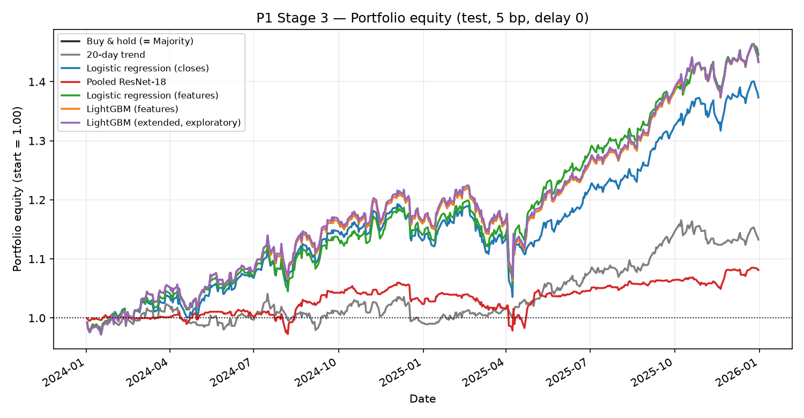
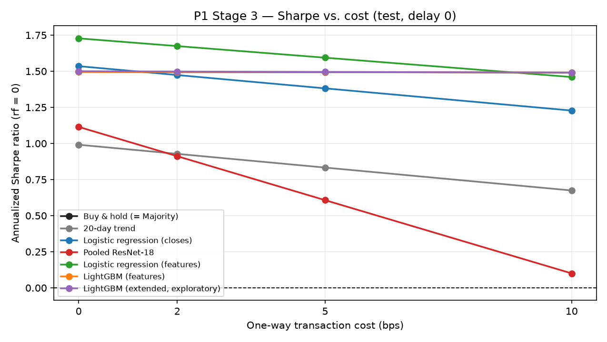

# P1 Stage 3 — Tabular vs. ResNet cost-aware backtest

> Post-hoc exploratory evaluation; LightGBM (extended) uses OHLCV + 60-session exploratory features. Long/flat equal-weight five-asset portfolio (`SPY`, `QQQ`, `IWM`, `TLT`, `GLD`) on dividend-adjusted `Adj Close` returns, market-on-close execution (`delay=0`), zero risk-free rate. Because the training majority class is 1 (`Up`), the constant majority baseline is identical to **Buy & hold**.

## Equal-weight portfolio (test, 0 bp & 5 bp one-way cost, delay 0)

| Model | Cost | CAGR | Ann. vol | Sharpe [95% CI] | Sortino | Max DD | Calmar | Turnover/yr | Exposure | Hit rate |
|---|---:|---:|---:|---|---:|---:|---:|---:|---:|---:|
| Buy & hold (= Majority) | 0 bp | 19.83% | 12.63% | 1.495 | 2.259 | -12.84% | 1.544 | 0.5x | 100.00% | 56.57% |
| Buy & hold (= Majority) | 5 bp | 19.80% | 12.63% | 1.493 [0.396, 2.878] | 2.255 | -12.84% | 1.542 | 0.5x | 100.00% | 56.57% |
| 20-day trend | 0 bp | 7.79% | 7.88% | 0.991 | 1.366 | -5.73% | 1.359 | 25.0x | 67.61% | 53.99% |
| 20-day trend | 5 bp | 6.45% | 7.88% | 0.833 [-0.293, 1.987] | 1.140 | -5.91% | 1.091 | 25.0x | 67.61% | 53.37% |
| Logistic regression (closes) | 0 bp | 19.43% | 12.04% | 1.535 | 2.345 | -12.79% | 1.519 | 36.7x | 92.27% | 56.77% |
| Logistic regression (closes) | 5 bp | 17.26% | 12.05% | 1.381 [0.310, 2.711] | 2.098 | -13.19% | 1.309 | 36.7x | 92.27% | 55.58% |
| Pooled ResNet-18 | 0 bp | 7.65% | 6.82% | 1.115 | 1.614 | -6.28% | 1.218 | 69.2x | 29.80% | 55.64% |
| Pooled ResNet-18 | 5 bp | 3.99% | 6.83% | 0.607 [-0.438, 1.838] | 0.864 | -7.68% | 0.519 | 69.2x | 29.80% | 53.08% |
| Logistic regression (features) | 0 bp | 22.27% | 12.06% | 1.728 | 2.723 | -11.67% | 1.908 | 32.1x | 92.11% | 56.69% |
| Logistic regression (features) | 5 bp | 20.32% | 12.07% | 1.594 [0.574, 2.790] | 2.497 | -11.79% | 1.724 | 32.1x | 92.11% | 56.09% |
| LightGBM (features) | 0 bp | 19.83% | 12.63% | 1.495 | 2.259 | -12.84% | 1.544 | 0.5x | 100.00% | 56.57% |
| LightGBM (features) | 5 bp | 19.80% | 12.63% | 1.493 [0.396, 2.878] | 2.255 | -12.84% | 1.542 | 0.5x | 100.00% | 56.57% |
| LightGBM (extended, exploratory) | 0 bp | 19.90% | 12.63% | 1.500 | 2.265 | -12.84% | 1.549 | 1.1x | 99.88% | 56.57% |
| LightGBM (extended, exploratory) | 5 bp | 19.83% | 12.63% | 1.495 [0.405, 2.860] | 2.258 | -12.84% | 1.544 | 1.1x | 99.88% | 56.57% |

## Portfolio Sharpe difference vs. Buy & hold (5 bp, delay 0, date-block bootstrap)

| Model − Buy & hold | Sharpe diff | 95% CI | Bootstrap p |
|---|---:|---|---:|
| 20-day trend − Buy & hold | -0.660 | [-1.654, +0.344] | 0.186 |
| Logistic regression (closes) − Buy & hold | -0.112 | [-0.444, +0.175] | 0.459 |
| Pooled ResNet-18 − Buy & hold | -0.886 | [-1.807, -0.087] | 0.03 |
| Logistic regression (features) − Buy & hold | +0.101 | [-0.265, +0.408] | 0.593 |
| LightGBM (features) − Buy & hold | +0.000 | [+0.000, +0.000] | 1 |
| LightGBM (extended, exploratory) − Buy & hold | +0.002 | [-0.035, +0.045] | 1 |

## Cost sensitivity (portfolio Sharpe, delay 0)

| Model | 0 bp | 2 bp | 5 bp | 10 bp |
|---|---:|---:|---:|---:|
| Buy & hold (= Majority) | 1.495 | 1.494 | 1.493 | 1.491 |
| 20-day trend | 0.991 | 0.928 | 0.833 | 0.674 |
| Logistic regression (closes) | 1.535 | 1.474 | 1.381 | 1.228 |
| Pooled ResNet-18 | 1.115 | 0.912 | 0.607 | 0.100 |
| Logistic regression (features) | 1.728 | 1.674 | 1.594 | 1.460 |
| LightGBM (features) | 1.495 | 1.494 | 1.493 | 1.491 |
| LightGBM (extended, exploratory) | 1.500 | 1.498 | 1.495 | 1.491 |

## Execution delay sensitivity (portfolio Sharpe, 0 bp and 5 bp)

| Model | Delay 0 (0 bp) | Delay 1 (0 bp) | Delay 0 (5 bp) | Delay 1 (5 bp) |
|---|---:|---:|---:|---:|
| Buy & hold (= Majority) | 1.495 | 1.526 | 1.493 | 1.524 |
| 20-day trend | 0.991 | 1.229 | 0.833 | 1.078 |
| Logistic regression (closes) | 1.535 | 1.721 | 1.381 | 1.568 |
| Pooled ResNet-18 | 1.115 | 1.152 | 0.607 | 0.638 |
| Logistic regression (features) | 1.728 | 1.498 | 1.594 | 1.364 |
| LightGBM (features) | 1.495 | 1.526 | 1.493 | 1.524 |
| LightGBM (extended, exploratory) | 1.500 | 1.522 | 1.495 | 1.517 |

## Per-asset sleeve Sharpe & CAGR (5 bp, delay 0)

| Asset | Model | CAGR | Sharpe | Max DD | Turnover/yr | Exposure |
|---|---|---:|---:|---:|---:|---:|
| SPY | Buy & hold (= Majority) | 21.31% | 1.262 | -18.76% | 0.5x | 100.00% |
| SPY | 20-day trend | 10.53% | 1.069 | -7.50% | 18.6x | 76.69% |
| SPY | Logistic regression (closes) | 17.14% | 1.081 | -17.86% | 24.6x | 94.82% |
| SPY | Pooled ResNet-18 | 7.23% | 0.625 | -8.38% | 70.3x | 31.87% |
| SPY | Logistic regression (features) | 22.82% | 1.364 | -18.76% | 4.5x | 99.20% |
| SPY | LightGBM (features) | 21.31% | 1.262 | -18.76% | 0.5x | 100.00% |
| SPY | LightGBM (extended, exploratory) | 21.31% | 1.262 | -18.76% | 0.5x | 100.00% |
| QQQ | Buy & hold (= Majority) | 23.22% | 1.101 | -22.77% | 0.5x | 100.00% |
| QQQ | 20-day trend | 9.18% | 0.729 | -15.99% | 25.1x | 74.70% |
| QQQ | Logistic regression (closes) | 17.60% | 0.907 | -22.46% | 45.7x | 90.44% |
| QQQ | Pooled ResNet-18 | 6.49% | 0.559 | -16.23% | 68.8x | 34.06% |
| QQQ | Logistic regression (features) | 24.25% | 1.153 | -22.77% | 5.5x | 98.80% |
| QQQ | LightGBM (features) | 23.22% | 1.101 | -22.77% | 0.5x | 100.00% |
| QQQ | LightGBM (extended, exploratory) | 23.22% | 1.101 | -22.77% | 0.5x | 100.00% |
| IWM | Buy & hold (= Majority) | 12.04% | 0.630 | -27.50% | 0.5x | 100.00% |
| IWM | 20-day trend | -0.28% | 0.063 | -14.95% | 27.6x | 63.94% |
| IWM | Logistic regression (closes) | 7.18% | 0.438 | -29.01% | 51.7x | 89.04% |
| IWM | Pooled ResNet-18 | -4.06% | -0.274 | -19.00% | 57.2x | 25.90% |
| IWM | Logistic regression (features) | 13.64% | 0.726 | -22.26% | 34.6x | 92.03% |
| IWM | LightGBM (features) | 12.04% | 0.630 | -27.50% | 0.5x | 100.00% |
| IWM | LightGBM (extended, exploratory) | 12.82% | 0.663 | -27.50% | 2.5x | 99.60% |
| TLT | Buy & hold (= Majority) | -2.13% | -0.099 | -14.79% | 0.5x | 100.00% |
| TLT | 20-day trend | -6.50% | -0.711 | -12.52% | 28.1x | 49.00% |
| TLT | Logistic regression (closes) | -3.81% | -0.235 | -17.60% | 13.6x | 97.41% |
| TLT | Pooled ResNet-18 | -3.43% | -0.421 | -13.24% | 81.3x | 32.07% |
| TLT | Logistic regression (features) | -0.32% | 0.038 | -14.32% | 29.6x | 94.02% |
| TLT | LightGBM (features) | -2.13% | -0.099 | -14.79% | 0.5x | 100.00% |
| TLT | LightGBM (extended, exploratory) | -2.13% | -0.099 | -14.79% | 0.5x | 100.00% |
| GLD | Buy & hold (= Majority) | 44.15% | 2.168 | -10.13% | 0.5x | 100.00% |
| GLD | 20-day trend | 18.14% | 1.124 | -14.76% | 25.6x | 73.71% |
| GLD | Logistic regression (closes) | 50.22% | 2.677 | -9.42% | 48.2x | 89.64% |
| GLD | Pooled ResNet-18 | 12.92% | 1.550 | -5.28% | 68.3x | 25.10% |
| GLD | Logistic regression (features) | 40.52% | 2.384 | -7.68% | 86.3x | 76.49% |
| GLD | LightGBM (features) | 44.15% | 2.168 | -10.13% | 0.5x | 100.00% |
| GLD | LightGBM (extended, exploratory) | 43.36% | 2.138 | -10.13% | 1.5x | 99.80% |

## Validation context (2022–2023, point estimates, delay 0)

| Model | Cost | CAGR | Sharpe | Max DD | Turnover/yr | Exposure |
|---|---:|---:|---:|---:|---:|---:|
| Buy & hold (= Majority) | 0 bp | -1.28% | -0.007 | -24.63% | 0.5x | 100.00% |
| Buy & hold (= Majority) | 5 bp | -1.30% | -0.009 | -24.67% | 0.5x | 100.00% |
| 20-day trend | 0 bp | 2.10% | 0.285 | -11.94% | 21.6x | 48.02% |
| 20-day trend | 5 bp | 1.00% | 0.159 | -12.56% | 21.6x | 48.02% |
| Logistic regression (closes) | 0 bp | 0.66% | 0.117 | -18.41% | 49.9x | 88.94% |
| Logistic regression (closes) | 5 bp | -1.82% | -0.063 | -19.25% | 49.9x | 88.94% |
| Pooled ResNet-18 | 0 bp | 0.35% | 0.083 | -12.61% | 71.5x | 33.81% |
| Pooled ResNet-18 | 5 bp | -3.18% | -0.353 | -14.91% | 71.5x | 33.81% |
| Logistic regression (features) | 0 bp | -5.18% | -0.288 | -24.21% | 40.3x | 89.54% |
| Logistic regression (features) | 5 bp | -7.07% | -0.425 | -25.87% | 40.3x | 89.54% |
| LightGBM (features) | 0 bp | -1.28% | -0.007 | -24.63% | 0.5x | 100.00% |
| LightGBM (features) | 5 bp | -1.30% | -0.009 | -24.67% | 0.5x | 100.00% |
| LightGBM (extended, exploratory) | 0 bp | -1.43% | -0.017 | -24.63% | 1.3x | 99.84% |
| LightGBM (extended, exploratory) | 5 bp | -1.49% | -0.022 | -24.67% | 1.3x | 99.84% |

