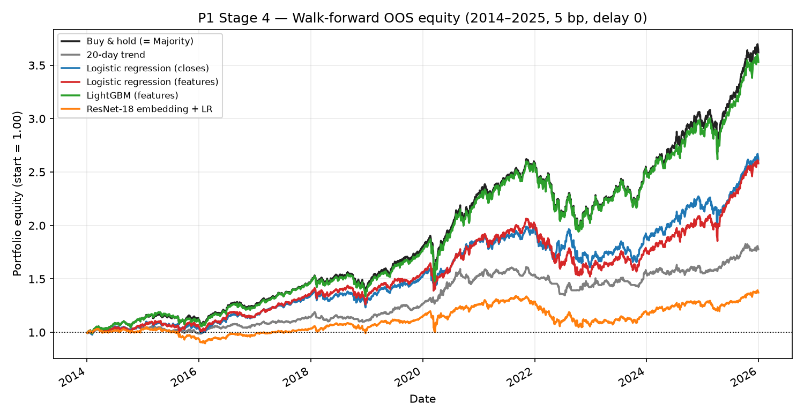
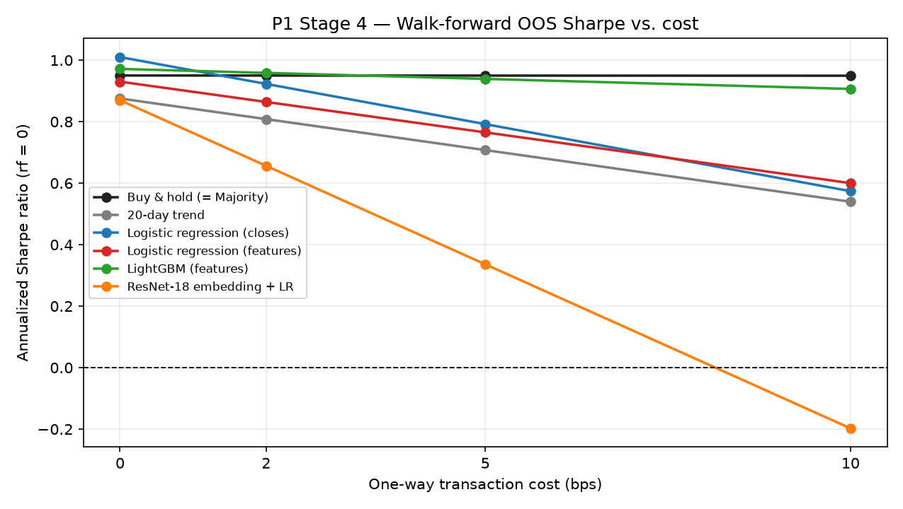

# P1 Stage 4 — Walk-forward OOS backtest (2014–2025)

> Walk-forward expanding OOS backtest (2014-2023 unseen; 2024-2025 previously observed). Long/flat equal-weight five-asset portfolio (`SPY`, `QQQ`, `IWM`, `TLT`, `GLD`) on dividend-adjusted `Adj Close` returns, market-on-close execution (`delay=0`), zero risk-free rate. Because the training majority class is 1 (`Up`), the constant majority baseline is identical to **Buy & hold**.

## Equal-weight portfolio (oos_2014_2025, 0 bp & 5 bp one-way cost, delay 0)

| Model | Cost | CAGR | Ann. vol | Sharpe [95% CI] | Sortino | Max DD | Calmar | Turnover/yr | Exposure | Hit rate |
|---|---:|---:|---:|---|---:|---:|---:|---:|---:|---:|
| Buy & hold (= Majority) | 0 bp | 11.35% | 12.08% | 0.950 | 1.352 | -25.55% | 0.444 | 0.1x | 100.00% | 56.30% |
| Buy & hold (= Majority) | 5 bp | 11.34% | 12.08% | 0.950 [0.384, 1.534] | 1.352 | -25.55% | 0.444 | 0.1x | 100.00% | 56.30% |
| 20-day trend | 0 bp | 6.18% | 7.14% | 0.875 | 1.237 | -15.65% | 0.394 | 23.9x | 59.50% | 54.55% |
| 20-day trend | 5 bp | 4.91% | 7.14% | 0.708 [0.143, 1.275] | 0.993 | -16.44% | 0.299 | 23.9x | 59.50% | 54.05% |
| Logistic regression (closes) | 0 bp | 10.96% | 10.88% | 1.010 | 1.466 | -17.27% | 0.635 | 47.4x | 88.94% | 55.88% |
| Logistic regression (closes) | 5 bp | 8.36% | 10.89% | 0.792 [0.269, 1.334] | 1.139 | -19.11% | 0.437 | 47.4x | 88.94% | 55.11% |
| Logistic regression (features) | 0 bp | 10.25% | 11.17% | 0.930 | 1.332 | -24.19% | 0.424 | 36.8x | 88.25% | 56.00% |
| Logistic regression (features) | 5 bp | 8.24% | 11.17% | 0.765 [0.252, 1.306] | 1.088 | -26.20% | 0.314 | 36.8x | 88.25% | 55.24% |
| LightGBM (features) | 0 bp | 11.54% | 11.98% | 0.972 | 1.385 | -25.33% | 0.456 | 7.8x | 98.02% | 56.46% |
| LightGBM (features) | 5 bp | 11.10% | 11.98% | 0.939 [0.377, 1.532] | 1.337 | -25.34% | 0.438 | 7.8x | 98.02% | 56.30% |
| ResNet-18 embedding + LR | 0 bp | 7.79% | 9.10% | 0.870 | 1.241 | -19.08% | 0.408 | 97.1x | 61.67% | 55.32% |
| ResNet-18 embedding + LR | 5 bp | 2.68% | 9.10% | 0.336 [-0.168, 0.863] | 0.471 | -21.81% | 0.123 | 97.1x | 61.67% | 52.97% |

## Portfolio Sharpe difference vs. Buy & hold (5 bp, delay 0, date-block bootstrap)

| Model − Buy & hold | Sharpe diff | 95% CI | Bootstrap p |
|---|---:|---|---:|
| 20-day trend − Buy & hold | -0.242 | [-0.730, +0.210] | 0.281 |
| Logistic regression (closes) − Buy & hold | -0.158 | [-0.411, +0.099] | 0.212 |
| Logistic regression (features) − Buy & hold | -0.185 | [-0.367, -0.009] | 0.0368 |
| LightGBM (features) − Buy & hold | -0.011 | [-0.062, +0.041] | 0.708 |
| ResNet-18 embedding + LR − Buy & hold | -0.614 | [-0.903, -0.345] | 0.0002 |

## Cost sensitivity (portfolio Sharpe, delay 0)

| Model | 0 bp | 2 bp | 5 bp | 10 bp |
|---|---:|---:|---:|---:|
| Buy & hold (= Majority) | 0.950 | 0.950 | 0.950 | 0.949 |
| 20-day trend | 0.875 | 0.808 | 0.708 | 0.540 |
| Logistic regression (closes) | 1.010 | 0.923 | 0.792 | 0.574 |
| Logistic regression (features) | 0.930 | 0.864 | 0.765 | 0.600 |
| LightGBM (features) | 0.972 | 0.959 | 0.939 | 0.907 |
| ResNet-18 embedding + LR | 0.870 | 0.656 | 0.336 | -0.198 |

## Execution delay sensitivity (portfolio Sharpe, 0 bp and 5 bp)

| Model | Delay 0 (0 bp) | Delay 1 (0 bp) | Delay 0 (5 bp) | Delay 1 (5 bp) |
|---|---:|---:|---:|---:|
| Buy & hold (= Majority) | 0.950 | 0.951 | 0.950 | 0.951 |
| 20-day trend | 0.875 | 0.857 | 0.708 | 0.695 |
| Logistic regression (closes) | 1.010 | 0.904 | 0.792 | 0.692 |
| Logistic regression (features) | 0.930 | 0.903 | 0.765 | 0.738 |
| LightGBM (features) | 0.972 | 0.994 | 0.939 | 0.961 |
| ResNet-18 embedding + LR | 0.870 | 0.754 | 0.336 | 0.224 |

## Per-asset sleeve Sharpe & CAGR (5 bp, delay 0)

| Asset | Model | CAGR | Sharpe | Max DD | Turnover/yr | Exposure |
|---|---|---:|---:|---:|---:|---:|
| SPY | Buy & hold (= Majority) | 13.45% | 0.815 | -33.72% | 0.1x | 100.00% |
| SPY | 20-day trend | 6.28% | 0.657 | -20.55% | 22.3x | 67.10% |
| SPY | Logistic regression (closes) | 13.27% | 0.868 | -21.29% | 40.0x | 90.66% |
| SPY | Logistic regression (features) | 13.85% | 0.875 | -22.99% | 15.9x | 95.49% |
| SPY | LightGBM (features) | 12.85% | 0.786 | -33.72% | 5.6x | 98.77% |
| SPY | ResNet-18 embedding + LR | 3.99% | 0.341 | -31.14% | 96.4x | 64.48% |
| QQQ | Buy & hold (= Majority) | 18.58% | 0.903 | -35.12% | 0.1x | 100.00% |
| QQQ | 20-day trend | 9.86% | 0.791 | -20.00% | 22.2x | 67.20% |
| QQQ | Logistic regression (closes) | 16.62% | 0.894 | -29.47% | 61.5x | 85.65% |
| QQQ | Logistic regression (features) | 17.20% | 0.896 | -36.49% | 24.6x | 92.05% |
| QQQ | LightGBM (features) | 18.50% | 0.903 | -35.12% | 6.9x | 98.34% |
| QQQ | ResNet-18 embedding + LR | 3.36% | 0.277 | -34.80% | 98.6x | 61.73% |
| IWM | Buy & hold (= Majority) | 7.93% | 0.457 | -41.13% | 0.1x | 100.00% |
| IWM | 20-day trend | 2.58% | 0.250 | -40.97% | 25.0x | 58.02% |
| IWM | Logistic regression (closes) | 1.42% | 0.171 | -43.08% | 65.2x | 84.29% |
| IWM | Logistic regression (features) | 2.72% | 0.234 | -48.72% | 40.3x | 87.74% |
| IWM | LightGBM (features) | 9.03% | 0.506 | -41.39% | 8.1x | 97.85% |
| IWM | ResNet-18 embedding + LR | -0.03% | 0.088 | -39.93% | 96.4x | 60.57% |
| TLT | Buy & hold (= Majority) | 1.42% | 0.169 | -48.35% | 0.1x | 100.00% |
| TLT | 20-day trend | -0.24% | 0.030 | -30.95% | 24.0x | 49.80% |
| TLT | Logistic regression (closes) | -1.12% | -0.014 | -53.84% | 30.1x | 93.24% |
| TLT | Logistic regression (features) | -0.57% | 0.024 | -51.13% | 38.0x | 89.60% |
| TLT | LightGBM (features) | 0.74% | 0.123 | -48.35% | 9.9x | 97.65% |
| TLT | ResNet-18 embedding + LR | -1.93% | -0.105 | -46.18% | 93.8x | 64.02% |
| GLD | Buy & hold (= Majority) | 10.79% | 0.768 | -24.49% | 0.1x | 100.00% |
| GLD | 20-day trend | 3.94% | 0.391 | -23.65% | 26.1x | 55.37% |
| GLD | Logistic regression (closes) | 8.39% | 0.666 | -28.38% | 40.2x | 90.85% |
| GLD | Logistic regression (features) | 4.77% | 0.433 | -35.39% | 65.3x | 76.38% |
| GLD | LightGBM (features) | 9.98% | 0.725 | -26.74% | 8.3x | 97.48% |
| GLD | ResNet-18 embedding + LR | 4.70% | 0.481 | -21.76% | 100.4x | 57.55% |

