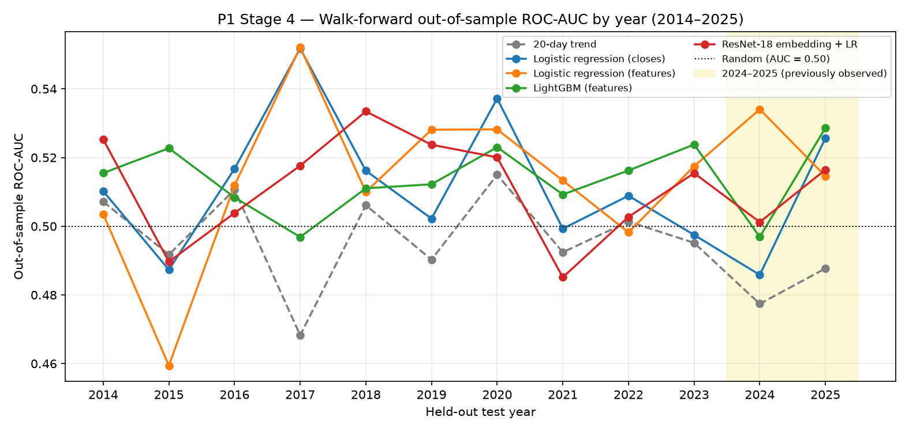

# P1 Stage 4 — Walk-forward validation (2014–2025)

> Expanding-window annual refit (`train: 2010..Y-2`, `val: Y-1`, `test: Y`). Below is the **2014–2023 unseen out-of-sample** summary (years never touched during Phase 1/2 model design), followed by the full 2014–2025 pooled OOS results and per-year breakdown.
> Fixed-split sanity check for `ResNet-18 embedding + LR`: test accuracy `52.59%`, ROC-AUC `0.510`, Pearson r vs. Stage 1 `resnet_pooled_prob` = `0.620`.

Climatology reference probability column: `climatology_prob`.
Uncertainty intervals are 95% percentile circular moving-block bootstrap over label dates (block 20 sessions, 5000 replicates).

## Overall (12,580 samples)

| Model | Accuracy [95% CI] | Balanced accuracy [95% CI] | ROC-AUC [95% CI] | Brier | Brier skill | Log loss | ECE | Binomial p |
|---|---|---|---|---:|---:|---:|---:|---:|
| Majority / climatology | 53.24% [52.11%, 54.41%] | 50.00% [50.00%, 50.00%] | 0.480 [0.468, 0.494] | 0.2491 | 0.0000 | 0.6913 | 0.0286 | 3.63e-13 |
| 20-day trend | 50.85% [49.79%, 51.90%] | 50.34% [49.31%, 51.32%] | 0.503 [0.493, 0.513] | — | — | — | — | 0.0576 |
| Logistic regression (closes) | 53.03% [51.90%, 54.11%] | 50.53% [49.85%, 51.20%] | 0.507 [0.494, 0.520] | 0.2499 | -0.0032 | 0.6930 | 0.0250 | 1.15e-11 |
| Logistic regression (features) | 52.67% [51.57%, 53.76%] | 50.24% [49.66%, 50.80%] | 0.507 [0.495, 0.519] | 0.2501 | -0.0041 | 0.6934 | 0.0274 | 2.18e-09 |
| LightGBM (features) | 53.38% [52.23%, 54.55%] | 50.23% [49.99%, 50.50%] | 0.500 [0.488, 0.511] | 0.2491 | -0.0001 | 0.6914 | 0.0195 | 3.67e-14 |
| ResNet-18 embedding + LR | 51.17% [50.19%, 52.08%] | 50.44% [49.52%, 51.32%] | 0.509 [0.498, 0.520] | 0.2676 | -0.0741 | 0.7357 | 0.1085 | 0.00899 |

## Per-asset metrics

| Asset | Up rate | Model | Accuracy | Balanced accuracy [95% CI] | ROC-AUC [95% CI] | Brier skill |
|---|---:|---|---:|---|---|---:|
| SPY | 54.29% | Majority / climatology | 54.29% | 50.00% [50.00%, 50.00%] | 0.476 [0.455, 0.497] | 0.0000 |
| SPY | 54.29% | 20-day trend | 51.43% | 50.13% [48.39%, 51.89%] | 0.501 [0.484, 0.519] | — |
| SPY | 54.29% | Logistic regression (closes) | 54.89% | 51.46% [50.22%, 52.74%] | 0.517 [0.496, 0.538] | 0.0011 |
| SPY | 54.29% | Logistic regression (features) | 54.49% | 50.64% [49.89%, 51.44%] | 0.500 [0.479, 0.523] | -0.0031 |
| SPY | 54.29% | LightGBM (features) | 54.33% | 50.15% [49.73%, 50.59%] | 0.492 [0.470, 0.514] | -0.0008 |
| SPY | 54.29% | ResNet-18 embedding + LR | 50.87% | 49.75% [47.99%, 51.47%] | 0.510 [0.487, 0.531] | -0.0690 |
| QQQ | 55.68% | Majority / climatology | 55.68% | 50.00% [50.00%, 50.00%] | 0.462 [0.440, 0.484] | 0.0000 |
| QQQ | 55.68% | 20-day trend | 52.78% | 51.01% [49.18%, 52.82%] | 0.510 [0.492, 0.528] | — |
| QQQ | 55.68% | Logistic regression (closes) | 55.17% | 51.21% [49.83%, 52.62%] | 0.518 [0.497, 0.539] | -0.0009 |
| QQQ | 55.68% | Logistic regression (features) | 55.01% | 50.36% [49.26%, 51.49%] | 0.501 [0.480, 0.522] | -0.0034 |
| QQQ | 55.68% | LightGBM (features) | 55.84% | 50.34% [49.81%, 50.88%] | 0.485 [0.463, 0.507] | -0.0009 |
| QQQ | 55.68% | ResNet-18 embedding + LR | 49.92% | 48.83% [46.78%, 50.87%] | 0.490 [0.468, 0.514] | -0.1005 |
| IWM | 52.98% | Majority / climatology | 52.98% | 50.00% [50.00%, 50.00%] | 0.489 [0.466, 0.511] | 0.0000 |
| IWM | 52.98% | 20-day trend | 49.88% | 49.47% [47.54%, 51.38%] | 0.495 [0.475, 0.514] | — |
| IWM | 52.98% | Logistic regression (closes) | 51.67% | 49.66% [48.15%, 51.15%] | 0.512 [0.491, 0.532] | -0.0056 |
| IWM | 52.98% | Logistic regression (features) | 51.87% | 49.67% [48.36%, 50.92%] | 0.499 [0.478, 0.520] | -0.0080 |
| IWM | 52.98% | LightGBM (features) | 53.22% | 50.31% [49.90%, 50.72%] | 0.508 [0.487, 0.529] | 0.0010 |
| IWM | 52.98% | ResNet-18 embedding + LR | 52.07% | 51.34% [49.44%, 53.20%] | 0.517 [0.495, 0.539] | -0.0716 |
| TLT | 51.59% | Majority / climatology | 51.59% | 50.00% [50.00%, 50.00%] | 0.493 [0.472, 0.513] | 0.0000 |
| TLT | 51.59% | 20-day trend | 49.88% | 49.88% [48.17%, 51.51%] | 0.499 [0.482, 0.515] | — |
| TLT | 51.59% | Logistic regression (closes) | 51.87% | 50.52% [49.52%, 51.50%] | 0.508 [0.485, 0.531] | -0.0043 |
| TLT | 51.59% | Logistic regression (features) | 51.63% | 50.40% [49.11%, 51.64%] | 0.521 [0.497, 0.546] | 0.0003 |
| TLT | 51.59% | LightGBM (features) | 51.63% | 50.09% [49.58%, 50.65%] | 0.519 [0.500, 0.539] | 0.0014 |
| TLT | 51.59% | ResNet-18 embedding + LR | 50.95% | 50.51% [48.65%, 52.36%] | 0.511 [0.489, 0.533] | -0.0688 |
| GLD | 51.67% | Majority / climatology | 51.67% | 50.00% [50.00%, 50.00%] | 0.482 [0.460, 0.504] | 0.0000 |
| GLD | 51.67% | 20-day trend | 50.28% | 50.22% [48.43%, 51.96%] | 0.502 [0.484, 0.520] | — |
| GLD | 51.67% | Logistic regression (closes) | 51.55% | 50.17% [49.08%, 51.21%] | 0.483 [0.461, 0.506] | -0.0062 |
| GLD | 51.67% | Logistic regression (features) | 50.36% | 49.50% [47.95%, 51.06%] | 0.486 [0.466, 0.506] | -0.0060 |
| GLD | 51.67% | LightGBM (features) | 51.87% | 50.26% [49.66%, 50.88%] | 0.490 [0.468, 0.513] | -0.0012 |
| GLD | 51.67% | ResNet-18 embedding + LR | 52.03% | 51.78% [49.99%, 53.52%] | 0.520 [0.501, 0.538] | -0.0611 |

## Paired differences on overall (A − B)

Positive differences favour A for accuracy, balanced accuracy and AUC; negative differences favour A for Brier and log loss.

| A − B | Metric | Difference | 95% CI | Bootstrap p |
|---|---|---:|---|---:|
| LightGBM (features) − Majority / climatology | accuracy | +0.14 pp | [-0.10, +0.39] pp | 0.303 |
| LightGBM (features) − Majority / climatology | balanced_accuracy | +0.23 pp | [-0.01, +0.50] pp | 0.0564 |
| LightGBM (features) − Majority / climatology | roc_auc | +0.0195 | [+0.0059, +0.0325] | 0.0036 |
| LightGBM (features) − Majority / climatology | brier | +0.0000 | [-0.0003, +0.0003] | 0.902 |
| LightGBM (features) − Majority / climatology | log_loss | +0.0000 | [-0.0006, +0.0006] | 0.884 |
| LightGBM (features) − Logistic regression (closes) | accuracy | +0.35 pp | [-0.40, +1.13] pp | 0.345 |
| LightGBM (features) − Logistic regression (closes) | balanced_accuracy | -0.30 pp | [-1.00, +0.41] pp | 0.425 |
| LightGBM (features) − Logistic regression (closes) | roc_auc | -0.0069 | [-0.0206, +0.0068] | 0.324 |
| LightGBM (features) − Logistic regression (closes) | brier | -0.0008 | [-0.0015, -0.0000] | 0.0432 |
| LightGBM (features) − Logistic regression (closes) | log_loss | -0.0016 | [-0.0032, -0.0001] | 0.0404 |
| LightGBM (features) − ResNet-18 embedding + LR | accuracy | +2.21 pp | [+0.96, +3.52] pp | 0.0008 |
| LightGBM (features) − ResNet-18 embedding + LR | balanced_accuracy | -0.21 pp | [-1.17, +0.77] pp | 0.703 |
| LightGBM (features) − ResNet-18 embedding + LR | roc_auc | -0.0095 | [-0.0243, +0.0055] | 0.226 |
| LightGBM (features) − ResNet-18 embedding + LR | brier | -0.0185 | [-0.0218, -0.0152] | 0.0002 |
| LightGBM (features) − ResNet-18 embedding + LR | log_loss | -0.0443 | [-0.0525, -0.0367] | 0.0002 |
| Logistic regression (features) − Logistic regression (closes) | accuracy | -0.36 pp | [-1.10, +0.40] pp | 0.388 |
| Logistic regression (features) − Logistic regression (closes) | balanced_accuracy | -0.29 pp | [-1.03, +0.47] pp | 0.486 |
| Logistic regression (features) − Logistic regression (closes) | roc_auc | -0.0002 | [-0.0137, +0.0136] | 0.984 |
| Logistic regression (features) − Logistic regression (closes) | brier | +0.0002 | [-0.0006, +0.0010] | 0.586 |
| Logistic regression (features) − Logistic regression (closes) | log_loss | +0.0004 | [-0.0012, +0.0021] | 0.614 |
| ResNet-18 embedding + LR − Logistic regression (closes) | accuracy | -1.86 pp | [-3.06, -0.67] pp | 0.0016 |
| ResNet-18 embedding + LR − Logistic regression (closes) | balanced_accuracy | -0.09 pp | [-1.16, +0.93] pp | 0.858 |
| ResNet-18 embedding + LR − Logistic regression (closes) | roc_auc | +0.0026 | [-0.0129, +0.0180] | 0.767 |
| ResNet-18 embedding + LR − Logistic regression (closes) | brier | +0.0177 | [+0.0145, +0.0210] | 0.0002 |
| ResNet-18 embedding + LR − Logistic regression (closes) | log_loss | +0.0427 | [+0.0352, +0.0506] | 0.0002 |

## Pooled 2014–2025 OOS overall (includes previously observed 2024–2025)

| Model | Accuracy [95% CI] | Balanced accuracy [95% CI] | ROC-AUC [95% CI] | Brier skill | Log loss |
|---|---|---|---|---:|---:|
| Majority / climatology | 53.58% [52.57%, 54.60%] | 50.00% [50.00%, 50.00%] | 0.482 [0.471, 0.494] | 0.0000 | 0.6908 |
| 20-day trend | 50.73% [49.79%, 51.67%] | 50.05% [49.15%, 50.92%] | 0.500 [0.491, 0.509] | — | — |
| Logistic regression (closes) | 53.36% [52.38%, 54.36%] | 50.58% [49.97%, 51.20%] | 0.506 [0.495, 0.518] | -0.0029 | 0.6923 |
| Logistic regression (features) | 53.06% [52.07%, 54.05%] | 50.32% [49.81%, 50.82%] | 0.509 [0.498, 0.520] | -0.0030 | 0.6923 |
| LightGBM (features) | 53.66% [52.66%, 54.69%] | 50.23% [50.00%, 50.47%] | 0.500 [0.490, 0.510] | -0.0004 | 0.6910 |
| ResNet-18 embedding + LR | 51.18% [50.32%, 52.02%] | 50.35% [49.55%, 51.15%] | 0.509 [0.499, 0.519] | -0.0678 | 0.7311 |

## Annual test ROC-AUC by year

| Year | Up rate | 20-day trend | LR (closes) | LR (features) | LightGBM | ResNet-18 emb + LR | Note |
|---:|---:|---:|---:|---:|---:|---:|---|
| 2014 | 55.40% | 0.507 | 0.510 | 0.504 | 0.515 | 0.525 | unseen OOS |
| 2015 | 49.21% | 0.492 | 0.487 | 0.459 | 0.523 | 0.490 | unseen OOS |
| 2016 | 53.33% | 0.511 | 0.517 | 0.512 | 0.508 | 0.504 | unseen OOS |
| 2017 | 56.33% | 0.468 | 0.552 | 0.552 | 0.497 | 0.518 | unseen OOS |
| 2018 | 51.87% | 0.506 | 0.516 | 0.510 | 0.511 | 0.533 | unseen OOS |
| 2019 | 57.14% | 0.490 | 0.502 | 0.528 | 0.512 | 0.524 | unseen OOS |
| 2020 | 57.08% | 0.515 | 0.537 | 0.528 | 0.523 | 0.520 | unseen OOS |
| 2021 | 52.22% | 0.492 | 0.499 | 0.513 | 0.509 | 0.485 | unseen OOS |
| 2022 | 46.53% | 0.501 | 0.509 | 0.498 | 0.516 | 0.503 | unseen OOS |
| 2023 | 53.28% | 0.495 | 0.497 | 0.517 | 0.524 | 0.515 | unseen OOS |
| 2024 | 55.08% | 0.477 | 0.486 | 0.534 | 0.497 | 0.501 | previously observed |
| 2025 | 55.44% | 0.488 | 0.526 | 0.515 | 0.529 | 0.516 | previously observed |

> **Note on walk-forward climatology AUC**: Across pooled walk-forward folds, the `Majority / climatology` column takes a different constant value per fold (`train_up_ratio` from `0.534` to `0.543`), which induces a spurious pooled ROC-AUC (`0.480` in 2014–2023 and `0.482` in 2014–2025) instead of `0.500`. Accordingly, walk-forward model AUCs should be evaluated against **0.500** rather than against the pooled `X − Majority` AUC difference (e.g., the `+0.0195` row for LightGBM reflects that spurious climatology ranking, not predictive skill).

