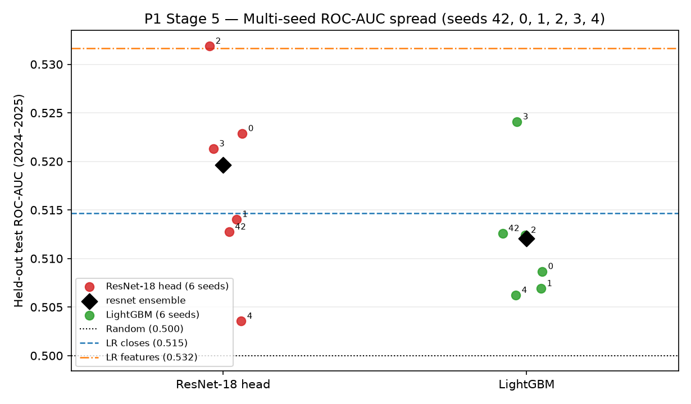

# P1 Stage 5 — Multi-seed robustness and Holm-corrected comparisons

> Post-hoc exploratory analysis over 6 seeds (`[42, 0, 1, 2, 3, 4]`). Per protocol amendment, ResNet-18 classifier heads are retrained on cached frozen-backbone embeddings (equivalence gate on 64 val images: `max |logit diff| = 2.38e-07 < 1e-4`).

## Across-seed distribution (2024–2025 held-out test, 2,510 samples)

| Family | Metric | Mean ± SD | Min | Max | Ensemble |
|---|---|---:|---:|---:|---:|
| ResNet-18 head | accuracy | 50.67% ± 2.84% | 47.89% | 55.78% | 49.96% |
| ResNet-18 head | balanced_accuracy | 50.99% ± 0.77% | 50.22% | 52.12% | 50.52% |
| ResNet-18 head | roc_auc | 0.5177 ± 0.0098 | 0.5036 | 0.5319 | 0.5197 |
| ResNet-18 head | log_loss | 0.6950 ± 0.0052 | 0.6863 | 0.7020 | 0.6933 |
| LightGBM (features) | accuracy | 55.27% ± 0.02% | 55.26% | 55.30% | 55.26% |
| LightGBM (features) | balanced_accuracy | 50.01% ± 0.03% | 50.00% | 50.08% | 50.00% |
| LightGBM (features) | roc_auc | 0.5118 ± 0.0066 | 0.5062 | 0.5241 | 0.5121 |
| LightGBM (features) | log_loss | 0.6878 ± 0.0002 | 0.6875 | 0.6880 | 0.6877 |

## Ensemble AUC vs. 0.50 (date-block bootstrap)

| Ensemble | ROC-AUC [95% CI] | Bootstrap p (vs 0.5) |
|---|---|---:|
| ResNet-18 head (6-seed ens) | 0.5197 [0.5007, 0.5391] | 0.044 |
| LightGBM (6-seed ens) | 0.5121 [0.4906, 0.5346] | 0.281 |

## Pre-specified 10-test family with Holm step-down correction

| Comparison (A − B) | Metric | Difference | 95% CI | Raw p | Holm adjusted p |
|---|---|---:|---|---:|---:|
| LightGBM (6-seed ens) − Majority / climatology | roc_auc | +0.0121 | [-0.0094, +0.0346] | 0.2808 | 1 |
| LightGBM (6-seed ens) − Majority / climatology | log_loss | -0.0002 | [-0.0008, +0.0005] | 0.614 | 1 |
| LightGBM (6-seed ens) − Logistic regression (closes) | roc_auc | -0.0026 | [-0.0280, +0.0253] | 0.8464 | 1 |
| LightGBM (6-seed ens) − Logistic regression (closes) | log_loss | -0.0001 | [-0.0028, +0.0025] | 0.9444 | 1 |
| ResNet-18 head (6-seed ens) − Logistic regression (closes) | roc_auc | +0.0050 | [-0.0233, +0.0319] | 0.724 | 1 |
| ResNet-18 head (6-seed ens) − Logistic regression (closes) | log_loss | +0.0055 | [+0.0000, +0.0107] | 0.0484 | 0.4356 |
| ResNet-18 head (6-seed ens) − LightGBM (6-seed ens) | roc_auc | +0.0076 | [-0.0181, +0.0326] | 0.5608 | 1 |
| ResNet-18 head (6-seed ens) − LightGBM (6-seed ens) | log_loss | +0.0056 | [+0.0011, +0.0101] | 0.014 | 0.14 |
| Logistic regression (features) − Logistic regression (closes) | roc_auc | +0.0170 | [-0.0046, +0.0400] | 0.1336 | 0.9352 |
| Logistic regression (features) − Logistic regression (closes) | log_loss | -0.0017 | [-0.0036, +0.0003] | 0.0912 | 0.7296 |

