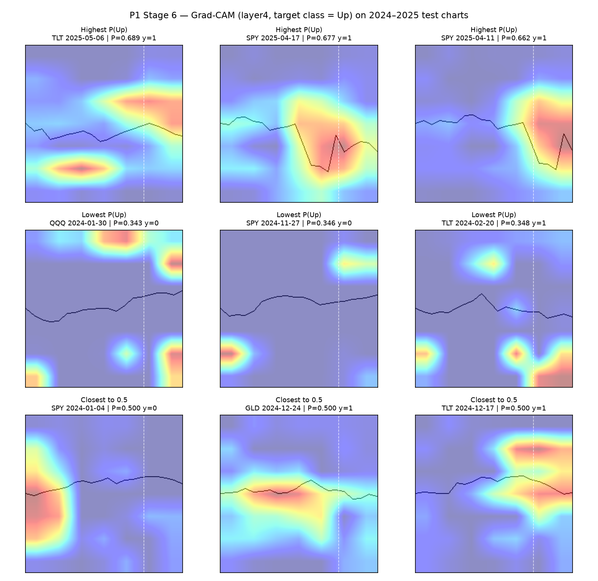
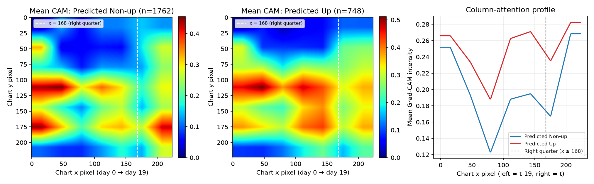
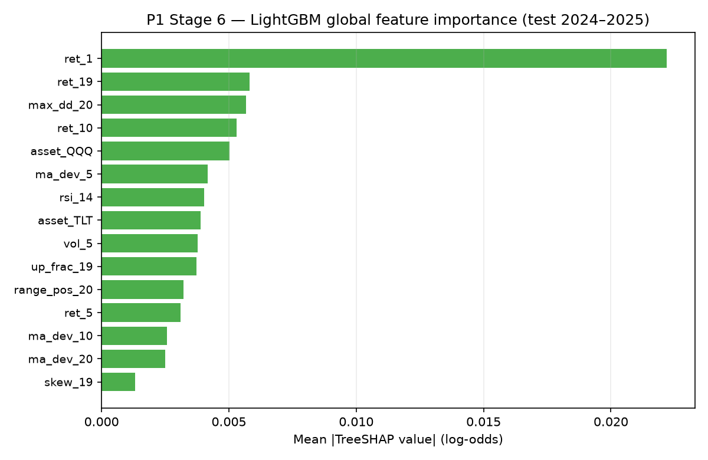
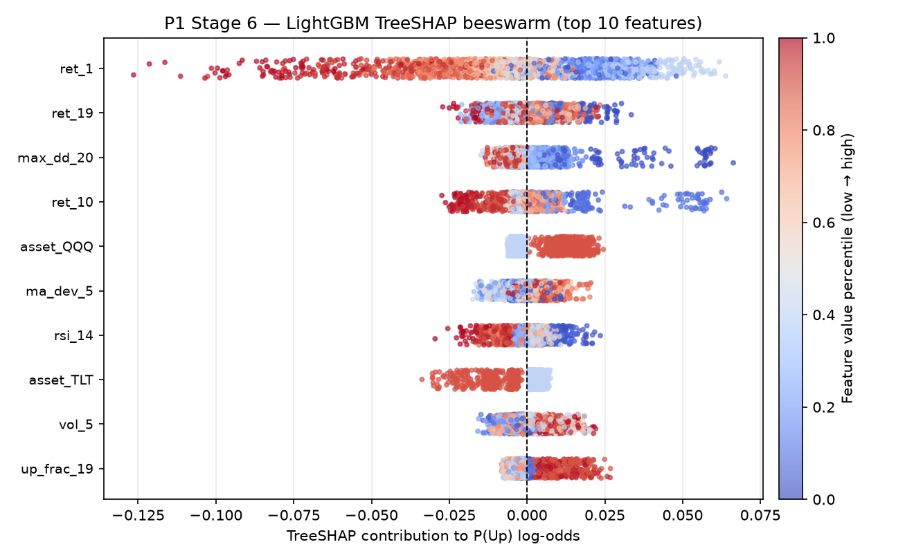
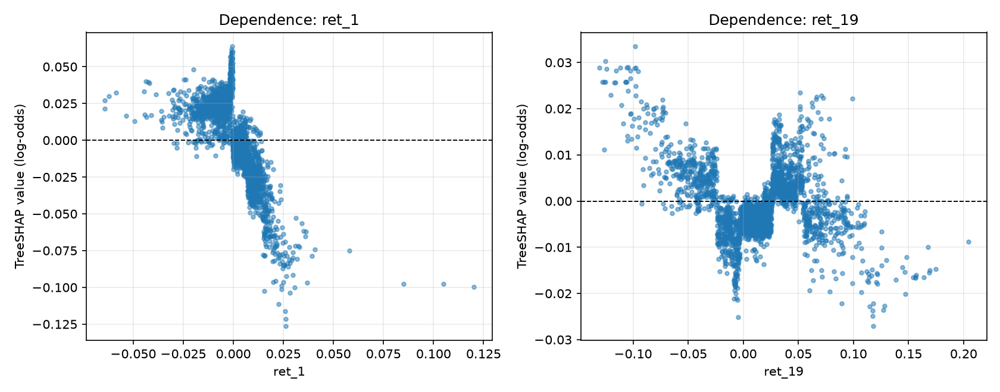

# P1 Stage 6 — Explainability: Grad-CAM (ResNet-18) & TreeSHAP (LightGBM)

## Grad-CAM on pooled ResNet-18 (`layer4`, 2,510 test charts)

| Subset | n | Mean right-quarter share (vs 0.250 uniform) | Mean line lift |
|---|---:|---:|---:|
| All test charts | 2510 | 0.2762 | 1.633x |
| Predicted Non-up | 1762 | 0.2820 | 1.587x |
| Predicted Up | 748 | 0.2627 | 1.742x |

## Native TreeSHAP on LightGBM (`lightgbm_seed42.txt`, 2,510 test samples)

- **Additivity verification gate**: `max |sum(SHAP) + bias - raw_score| = 1.67e-16 < 1e-6`.
- **Base value (log-odds)**: `0.1613`.

| Rank | Feature | Mean |SHAP| (log-odds) |
|---:|---|---:|
| 1 | `ret_1` | 0.02218 |
| 2 | `ret_19` | 0.00581 |
| 3 | `max_dd_20` | 0.00567 |
| 4 | `ret_10` | 0.00530 |
| 5 | `asset_QQQ` | 0.00503 |
| 6 | `ma_dev_5` | 0.00416 |
| 7 | `rsi_14` | 0.00403 |
| 8 | `asset_TLT` | 0.00390 |
| 9 | `vol_5` | 0.00377 |
| 10 | `up_frac_19` | 0.00374 |

