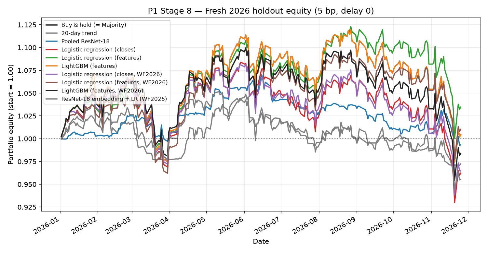
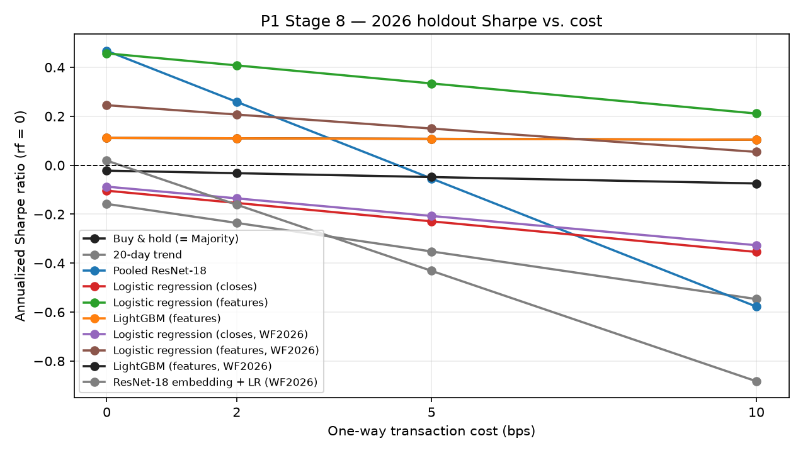

# P1 Stage 8 — 2026 fresh holdout cost-aware backtest

> Confirmatory 2026 holdout (secondary economic evaluation on frozen models). Long/flat equal-weight five-asset portfolio (`SPY`, `QQQ`, `IWM`, `TLT`, `GLD`) on dividend-adjusted `Adj Close` returns, market-on-close execution (`delay=0`), zero risk-free rate. Because the training majority class is 1 (`Up`), the constant majority baseline is identical to **Buy & hold**.

## Equal-weight portfolio (holdout_2026, 0 bp & 5 bp one-way cost, delay 0)

| Model | Cost | CAGR | Ann. vol | Sharpe [95% CI] | Sortino | Max DD | Calmar | Turnover/yr | Exposure | Hit rate |
|---|---:|---:|---:|---|---:|---:|---:|---:|---:|---:|
| Buy & hold (= Majority) | 0 bp | 0.54% | 15.41% | 0.112 | 0.156 | -13.00% | 0.041 | 1.1x | 100.00% | 50.22% |
| Buy & hold (= Majority) | 5 bp | 0.48% | 15.41% | 0.108 [-1.500, 1.866] | 0.151 | -13.00% | 0.037 | 1.1x | 100.00% | 50.22% |
| 20-day trend | 0 bp | -1.56% | 7.95% | -0.158 | -0.204 | -6.76% | -0.231 | 30.9x | 45.20% | 53.61% |
| 20-day trend | 5 bp | -3.07% | 7.94% | -0.352 [-2.409, 1.666] | -0.452 | -7.46% | -0.411 | 30.9x | 45.20% | 51.55% |
| Pooled ResNet-18 | 0 bp | 3.48% | 8.00% | 0.467 | 0.709 | -7.26% | 0.480 | 83.5x | 37.71% | 49.48% |
| Pooled ResNet-18 | 5 bp | -0.75% | 7.99% | -0.054 [-1.509, 1.695] | -0.081 | -8.86% | -0.084 | 83.5x | 37.71% | 48.45% |
| Logistic regression (closes) | 0 bp | -2.46% | 14.24% | -0.104 | -0.146 | -13.49% | -0.182 | 35.7x | 92.07% | 48.90% |
| Logistic regression (closes) | 5 bp | -4.19% | 14.25% | -0.229 [-1.922, 1.543] | -0.321 | -14.20% | -0.295 | 35.7x | 92.07% | 48.46% |
| Logistic regression (features) | 0 bp | 5.70% | 14.37% | 0.457 | 0.656 | -10.63% | 0.536 | 35.3x | 91.37% | 51.54% |
| Logistic regression (features) | 5 bp | 3.85% | 14.38% | 0.334 [-1.253, 2.089] | 0.477 | -10.92% | 0.352 | 35.3x | 91.37% | 51.10% |
| LightGBM (features) | 0 bp | 0.54% | 15.41% | 0.112 | 0.156 | -13.00% | 0.041 | 1.1x | 100.00% | 50.22% |
| LightGBM (features) | 5 bp | 0.48% | 15.41% | 0.108 [-1.500, 1.866] | 0.151 | -13.00% | 0.037 | 1.1x | 100.00% | 50.22% |
| Logistic regression (closes, WF2026) | 0 bp | -2.25% | 14.35% | -0.087 | -0.124 | -12.61% | -0.179 | 34.4x | 91.89% | 49.34% |
| Logistic regression (closes, WF2026) | 5 bp | -3.92% | 14.36% | -0.207 [-1.751, 1.441] | -0.293 | -13.25% | -0.296 | 34.4x | 91.89% | 48.02% |
| Logistic regression (features, WF2026) | 0 bp | 2.52% | 14.31% | 0.245 | 0.351 | -10.68% | 0.236 | 27.3x | 91.37% | 50.66% |
| Logistic regression (features, WF2026) | 5 bp | 1.13% | 14.31% | 0.150 [-1.441, 1.917] | 0.213 | -11.14% | 0.102 | 27.3x | 91.37% | 50.22% |
| LightGBM (features, WF2026) | 0 bp | -1.41% | 14.84% | -0.022 | -0.031 | -13.16% | -0.107 | 7.8x | 96.48% | 48.90% |
| LightGBM (features, WF2026) | 5 bp | -1.79% | 14.84% | -0.048 [-1.567, 1.586] | -0.068 | -13.19% | -0.136 | 7.8x | 96.48% | 48.90% |
| ResNet-18 embedding + LR (WF2026) | 0 bp | -0.35% | 10.51% | 0.019 | 0.027 | -7.92% | -0.044 | 94.6x | 63.79% | 49.10% |
| ResNet-18 embedding + LR (WF2026) | 5 bp | -4.95% | 10.50% | -0.431 [-1.875, 1.205] | -0.607 | -10.23% | -0.484 | 94.6x | 63.79% | 49.10% |

## Portfolio Sharpe difference vs. Buy & hold (5 bp, delay 0, date-block bootstrap)

| Model − Buy & hold | Sharpe diff | 95% CI | Bootstrap p |
|---|---:|---|---:|
| 20-day trend − Buy & hold | -0.460 | [-1.588, +0.702] | 0.392 |
| Pooled ResNet-18 − Buy & hold | -0.162 | [-1.413, +1.220] | 0.819 |
| Logistic regression (closes) − Buy & hold | -0.337 | [-0.715, +0.042] | 0.0772 |
| Logistic regression (features) − Buy & hold | +0.226 | [-0.092, +0.618] | 0.172 |
| LightGBM (features) − Buy & hold | +0.000 | [+0.000, +0.000] | 1 |
| Logistic regression (closes, WF2026) − Buy & hold | -0.315 | [-0.661, +0.045] | 0.0844 |
| Logistic regression (features, WF2026) − Buy & hold | +0.042 | [-0.309, +0.394] | 0.768 |
| LightGBM (features, WF2026) − Buy & hold | -0.156 | [-0.415, +0.099] | 0.235 |
| ResNet-18 embedding + LR (WF2026) − Buy & hold | -0.539 | [-1.347, +0.222] | 0.168 |

## Cost sensitivity (portfolio Sharpe, delay 0)

| Model | 0 bp | 2 bp | 5 bp | 10 bp |
|---|---:|---:|---:|---:|
| Buy & hold (= Majority) | 0.112 | 0.110 | 0.108 | 0.104 |
| 20-day trend | -0.158 | -0.236 | -0.352 | -0.547 |
| Pooled ResNet-18 | 0.467 | 0.259 | -0.054 | -0.577 |
| Logistic regression (closes) | -0.104 | -0.154 | -0.229 | -0.354 |
| Logistic regression (features) | 0.457 | 0.408 | 0.334 | 0.211 |
| LightGBM (features) | 0.112 | 0.110 | 0.108 | 0.104 |
| Logistic regression (closes, WF2026) | -0.087 | -0.135 | -0.207 | -0.327 |
| Logistic regression (features, WF2026) | 0.245 | 0.207 | 0.150 | 0.054 |
| LightGBM (features, WF2026) | -0.022 | -0.032 | -0.048 | -0.074 |
| ResNet-18 embedding + LR (WF2026) | 0.019 | -0.161 | -0.431 | -0.882 |

## Execution delay sensitivity (portfolio Sharpe, 0 bp and 5 bp)

| Model | Delay 0 (0 bp) | Delay 1 (0 bp) | Delay 0 (5 bp) | Delay 1 (5 bp) |
|---|---:|---:|---:|---:|
| Buy & hold (= Majority) | 0.112 | 0.091 | 0.108 | 0.088 |
| 20-day trend | -0.158 | -0.108 | -0.352 | -0.296 |
| Pooled ResNet-18 | 0.467 | -0.828 | -0.054 | -1.297 |
| Logistic regression (closes) | -0.104 | 0.516 | -0.229 | 0.391 |
| Logistic regression (features) | 0.457 | 0.569 | 0.334 | 0.447 |
| LightGBM (features) | 0.112 | 0.091 | 0.108 | 0.088 |
| Logistic regression (closes, WF2026) | -0.087 | 0.474 | -0.207 | 0.355 |
| Logistic regression (features, WF2026) | 0.245 | 0.261 | 0.150 | 0.168 |
| LightGBM (features, WF2026) | -0.022 | 0.097 | -0.048 | 0.071 |
| ResNet-18 embedding + LR (WF2026) | 0.019 | -0.194 | -0.431 | -0.641 |

## Per-asset sleeve Sharpe & CAGR (5 bp, delay 0)

| Asset | Model | CAGR | Sharpe | Max DD | Turnover/yr | Exposure |
|---|---|---:|---:|---:|---:|---:|
| SPY | Buy & hold (= Majority) | 6.54% | 0.487 | -11.46% | 1.1x | 100.00% |
| SPY | 20-day trend | -4.59% | -0.535 | -9.45% | 44.4x | 51.98% |
| SPY | Pooled ResNet-18 | -2.46% | -0.190 | -9.77% | 96.6x | 35.24% |
| SPY | Logistic regression (closes) | 2.52% | 0.239 | -11.46% | 10.0x | 98.24% |
| SPY | Logistic regression (features) | 6.99% | 0.515 | -11.46% | 3.3x | 99.56% |
| SPY | LightGBM (features) | 6.54% | 0.487 | -11.46% | 1.1x | 100.00% |
| SPY | Logistic regression (closes, WF2026) | 3.87% | 0.324 | -11.28% | 14.4x | 96.92% |
| SPY | Logistic regression (features, WF2026) | 6.99% | 0.515 | -11.46% | 3.3x | 99.56% |
| SPY | LightGBM (features, WF2026) | 7.20% | 0.527 | -11.46% | 3.3x | 99.56% |
| SPY | ResNet-18 embedding + LR (WF2026) | -1.73% | -0.091 | -10.37% | 98.8x | 66.96% |
| QQQ | Buy & hold (= Majority) | 3.89% | 0.278 | -19.90% | 1.1x | 100.00% |
| QQQ | 20-day trend | -1.71% | -0.061 | -14.34% | 24.4x | 45.81% |
| QQQ | Pooled ResNet-18 | -9.48% | -0.514 | -12.86% | 65.5x | 35.68% |
| QQQ | Logistic regression (closes) | -5.43% | -0.127 | -23.09% | 56.6x | 87.67% |
| QQQ | Logistic regression (features) | 7.25% | 0.411 | -19.90% | 14.4x | 97.36% |
| QQQ | LightGBM (features) | 3.89% | 0.278 | -19.90% | 1.1x | 100.00% |
| QQQ | Logistic regression (closes, WF2026) | -1.45% | 0.052 | -19.41% | 52.2x | 88.55% |
| QQQ | Logistic regression (features, WF2026) | 7.77% | 0.431 | -19.90% | 10.0x | 98.24% |
| QQQ | LightGBM (features, WF2026) | -3.52% | -0.032 | -19.90% | 10.0x | 94.27% |
| QQQ | ResNet-18 embedding + LR (WF2026) | -1.74% | 0.016 | -15.95% | 92.1x | 62.11% |
| IWM | Buy & hold (= Majority) | 11.06% | 0.638 | -15.67% | 1.1x | 100.00% |
| IWM | 20-day trend | -11.17% | -0.804 | -15.76% | 35.5x | 56.39% |
| IWM | Pooled ResNet-18 | 7.60% | 0.702 | -7.30% | 98.8x | 37.00% |
| IWM | Logistic regression (closes) | -2.84% | -0.071 | -15.50% | 38.9x | 91.63% |
| IWM | Logistic regression (features) | 1.22% | 0.158 | -17.83% | 34.4x | 92.95% |
| IWM | LightGBM (features) | 11.06% | 0.638 | -15.67% | 1.1x | 100.00% |
| IWM | Logistic regression (closes, WF2026) | 3.21% | 0.264 | -13.16% | 37.7x | 91.63% |
| IWM | Logistic regression (features, WF2026) | 3.92% | 0.298 | -16.53% | 25.5x | 94.71% |
| IWM | LightGBM (features, WF2026) | 8.01% | 0.496 | -15.67% | 7.8x | 97.36% |
| IWM | ResNet-18 embedding + LR (WF2026) | -5.80% | -0.301 | -12.92% | 92.1x | 64.76% |
| TLT | Buy & hold (= Majority) | -2.21% | -0.173 | -12.47% | 1.1x | 100.00% |
| TLT | 20-day trend | -6.54% | -1.209 | -7.42% | 32.2x | 34.36% |
| TLT | Pooled ResNet-18 | -4.27% | -0.679 | -7.54% | 77.7x | 36.56% |
| TLT | Logistic regression (closes) | -2.54% | -0.207 | -12.47% | 3.3x | 99.56% |
| TLT | Logistic regression (features) | -1.24% | -0.076 | -11.65% | 27.8x | 94.27% |
| TLT | LightGBM (features) | -2.21% | -0.173 | -12.47% | 1.1x | 100.00% |
| TLT | Logistic regression (closes, WF2026) | -2.64% | -0.217 | -12.55% | 5.6x | 99.12% |
| TLT | Logistic regression (features, WF2026) | -1.11% | -0.064 | -11.55% | 21.1x | 94.71% |
| TLT | LightGBM (features, WF2026) | -2.21% | -0.173 | -12.47% | 1.1x | 100.00% |
| TLT | ResNet-18 embedding + LR (WF2026) | -5.68% | -0.655 | -10.80% | 104.4x | 63.00% |
| GLD | Buy & hold (= Majority) | -19.14% | -0.544 | -34.89% | 1.1x | 100.00% |
| GLD | 20-day trend | 6.52% | 0.400 | -19.08% | 17.8x | 37.44% |
| GLD | Pooled ResNet-18 | 3.16% | 0.266 | -20.76% | 78.8x | 44.05% |
| GLD | Logistic regression (closes) | -15.71% | -0.527 | -31.45% | 69.9x | 83.26% |
| GLD | Logistic regression (features) | 0.94% | 0.161 | -21.72% | 96.6x | 72.69% |
| GLD | LightGBM (features) | -19.14% | -0.544 | -34.89% | 1.1x | 100.00% |
| GLD | Logistic regression (closes, WF2026) | -23.88% | -0.883 | -37.72% | 62.2x | 83.26% |
| GLD | Logistic regression (features, WF2026) | -14.36% | -0.517 | -23.75% | 76.6x | 69.60% |
| GLD | LightGBM (features, WF2026) | -20.13% | -0.690 | -35.60% | 16.7x | 91.19% |
| GLD | ResNet-18 embedding + LR (WF2026) | -13.20% | -0.524 | -26.85% | 85.5x | 62.11% |

