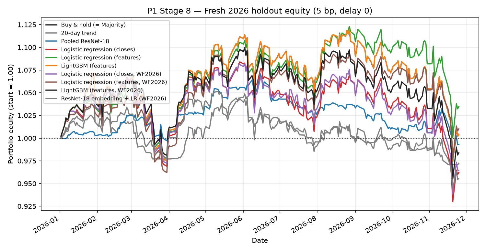

# P1 Stage 8 — Confirmatory 2026 holdout evaluation

> **Confirmatory out-of-time evaluation** (`2026-01-02` to `2026-11-25`, `1,135` samples across 5 ETFs). All models and hypotheses were frozen and pushed prior to download (pre-registration commit `5aa00e4785af31c2f5acfd9c9b5685676bd10482`).

Climatology reference probability (training up-ratio): **0.5356**.
Uncertainty intervals are 95% percentile circular moving-block bootstrap over label dates (block 20 sessions, 5000 replicates).

## Overall (1,135 samples)

| Model | Accuracy [95% CI] | Balanced accuracy [95% CI] | ROC-AUC [95% CI] | Brier | Brier skill | Log loss | ECE | Binomial p |
|---|---|---|---|---:|---:|---:|---:|---:|
| Majority / climatology | 51.01% [47.31%, 54.54%] | 50.00% [50.00%, 50.00%] | 0.500 [0.500, 0.500] | 0.2505 | 0.0000 | 0.6942 | 0.0516 | 0.514 |
| 20-day trend | 49.07% [46.52%, 51.98%] | 49.17% [46.42%, 51.92%] | 0.492 [0.464, 0.519] | — | — | — | — | 0.553 |
| Pooled ResNet-18 | 49.87% [47.40%, 52.42%] | 50.12% [47.69%, 52.72%] | 0.485 [0.449, 0.522] | 0.2540 | -0.0136 | 0.7012 | 0.0586 | 0.953 |
| LR (closes, 2010–21) | 49.25% [45.81%, 52.60%] | 48.40% [47.21%, 49.64%] | 0.494 [0.454, 0.538] | 0.2525 | -0.0078 | 0.6982 | 0.0636 | 0.635 |
| LR (features, 2010–21) | 51.54% [48.46%, 54.45%] | 50.70% [49.27%, 51.95%] | 0.519 [0.484, 0.557] | 0.2507 | -0.0005 | 0.6945 | 0.0500 | 0.313 |
| LightGBM (2010–21) | 51.01% [47.31%, 54.54%] | 50.00% [50.00%, 50.00%] | 0.495 [0.471, 0.521] | 0.2511 | -0.0024 | 0.6954 | 0.0609 | 0.514 |
| LR (closes, WF2026) | 49.60% [46.43%, 52.42%] | 48.75% [47.48%, 50.14%] | 0.472 [0.426, 0.518] | 0.2527 | -0.0086 | 0.6986 | 0.0591 | 0.812 |
| LR (features, WF2026) | 50.66% [47.67%, 53.74%] | 49.82% [48.41%, 51.20%] | 0.523 [0.485, 0.562] | 0.2502 | 0.0015 | 0.6934 | 0.0402 | 0.678 |
| LightGBM (WF2026) | 49.60% [46.34%, 52.78%] | 48.66% [47.63%, 49.62%] | 0.506 [0.481, 0.534] | 0.2507 | -0.0004 | 0.6945 | 0.0404 | 0.812 |
| ResNet-18 emb + LR (WF2026) | 50.57% [48.28%, 53.04%] | 50.29% [48.03%, 52.74%] | 0.493 [0.462, 0.524] | 0.2599 | -0.0372 | 0.7143 | 0.0957 | 0.722 |

## Per-asset metrics

| Asset | Up rate | Model | Accuracy | Balanced accuracy [95% CI] | ROC-AUC [95% CI] | Brier skill |
|---|---:|---|---:|---|---|---:|
| SPY | 49.34% | Majority / climatology | 49.34% | 50.00% [50.00%, 50.00%] | 0.500 [0.500, 0.500] | 0.0000 |
| SPY | 49.34% | 20-day trend | 47.14% | 47.16% [40.89%, 53.27%] | 0.472 [0.409, 0.533] | — |
| SPY | 49.34% | Pooled ResNet-18 | 50.66% | 50.47% [43.67%, 57.39%] | 0.501 [0.413, 0.596] | -0.0020 |
| SPY | 49.34% | LR (closes, 2010–21) | 48.46% | 49.10% [47.78%, 50.13%] | 0.522 [0.463, 0.588] | -0.0013 |
| SPY | 49.34% | LR (features, 2010–21) | 49.78% | 50.43% [50.00%, 51.32%] | 0.491 [0.422, 0.555] | -0.0065 |
| SPY | 49.34% | LightGBM (2010–21) | 49.34% | 50.00% [50.00%, 50.00%] | 0.500 [0.445, 0.555] | -0.0018 |
| SPY | 49.34% | LR (closes, WF2026) | 49.78% | 50.40% [48.53%, 52.25%] | 0.506 [0.430, 0.585] | 0.0004 |
| SPY | 49.34% | LR (features, WF2026) | 49.78% | 50.43% [50.00%, 51.32%] | 0.485 [0.396, 0.568] | -0.0031 |
| SPY | 49.34% | LightGBM (WF2026) | 49.78% | 50.43% [50.00%, 51.46%] | 0.473 [0.417, 0.529] | -0.0012 |
| SPY | 49.34% | ResNet-18 emb + LR (WF2026) | 50.66% | 50.89% [45.01%, 57.10%] | 0.513 [0.448, 0.583] | -0.0200 |
| QQQ | 51.98% | Majority / climatology | 51.98% | 50.00% [50.00%, 50.00%] | 0.500 [0.500, 0.500] | 0.0000 |
| QQQ | 51.98% | 20-day trend | 48.90% | 49.06% [42.56%, 54.89%] | 0.491 [0.426, 0.549] | — |
| QQQ | 51.98% | Pooled ResNet-18 | 44.93% | 45.49% [38.87%, 52.99%] | 0.464 [0.392, 0.546] | -0.0232 |
| QQQ | 51.98% | LR (closes, 2010–21) | 49.34% | 47.84% [44.67%, 51.44%] | 0.445 [0.386, 0.510] | -0.0175 |
| QQQ | 51.98% | LR (features, 2010–21) | 51.98% | 50.10% [48.11%, 51.95%] | 0.514 [0.468, 0.563] | -0.0048 |
| QQQ | 51.98% | LightGBM (2010–21) | 51.98% | 50.00% [50.00%, 50.00%] | 0.444 [0.381, 0.523] | -0.0057 |
| QQQ | 51.98% | LR (closes, WF2026) | 48.46% | 46.93% [43.73%, 50.53%] | 0.434 [0.368, 0.506] | -0.0139 |
| QQQ | 51.98% | LR (features, WF2026) | 52.86% | 50.95% [49.99%, 52.27%] | 0.529 [0.475, 0.587] | 0.0024 |
| QQQ | 51.98% | LightGBM (WF2026) | 50.66% | 48.90% [47.61%, 50.00%] | 0.474 [0.406, 0.564] | -0.0041 |
| QQQ | 51.98% | ResNet-18 emb + LR (WF2026) | 52.86% | 52.39% [48.28%, 56.65%] | 0.509 [0.462, 0.561] | -0.0229 |
| IWM | 55.07% | Majority / climatology | 55.07% | 50.00% [50.00%, 50.00%] | 0.500 [0.500, 0.500] | 0.0000 |
| IWM | 55.07% | 20-day trend | 47.58% | 46.90% [40.33%, 52.67%] | 0.469 [0.403, 0.527] | — |
| IWM | 55.07% | Pooled ResNet-18 | 50.22% | 51.55% [47.25%, 56.08%] | 0.481 [0.420, 0.548] | -0.0325 |
| IWM | 55.07% | LR (closes, 2010–21) | 50.22% | 45.96% [42.49%, 49.27%] | 0.470 [0.414, 0.528] | -0.0108 |
| IWM | 55.07% | LR (features, 2010–21) | 51.54% | 47.16% [44.47%, 49.99%] | 0.508 [0.459, 0.561] | -0.0029 |
| IWM | 55.07% | LightGBM (2010–21) | 55.07% | 50.00% [50.00%, 50.00%] | 0.487 [0.431, 0.550] | -0.0019 |
| IWM | 55.07% | LR (closes, WF2026) | 51.98% | 47.74% [45.45%, 50.19%] | 0.456 [0.393, 0.525] | -0.0113 |
| IWM | 55.07% | LR (features, WF2026) | 52.42% | 47.87% [45.52%, 50.20%] | 0.518 [0.467, 0.577] | -0.0010 |
| IWM | 55.07% | LightGBM (WF2026) | 53.30% | 48.49% [45.99%, 50.00%] | 0.485 [0.434, 0.544] | -0.0044 |
| IWM | 55.07% | ResNet-18 emb + LR (WF2026) | 48.02% | 46.49% [41.82%, 52.11%] | 0.440 [0.377, 0.512] | -0.0675 |
| TLT | 47.58% | Majority / climatology | 47.58% | 50.00% [50.00%, 50.00%] | 0.500 [0.500, 0.500] | 0.0000 |
| TLT | 47.58% | 20-day trend | 48.02% | 47.25% [41.72%, 51.60%] | 0.473 [0.417, 0.516] | — |
| TLT | 47.58% | Pooled ResNet-18 | 51.10% | 50.45% [43.43%, 57.65%] | 0.474 [0.393, 0.566] | -0.0025 |
| TLT | 47.58% | LR (closes, 2010–21) | 47.14% | 49.54% [48.58%, 50.00%] | 0.481 [0.409, 0.553] | -0.0091 |
| TLT | 47.58% | LR (features, 2010–21) | 50.66% | 52.81% [50.65%, 55.01%] | 0.526 [0.456, 0.592] | 0.0068 |
| TLT | 47.58% | LightGBM (2010–21) | 47.58% | 50.00% [50.00%, 50.00%] | 0.520 [0.465, 0.583] | 0.0003 |
| TLT | 47.58% | LR (closes, WF2026) | 47.58% | 49.96% [48.68%, 51.18%] | 0.458 [0.386, 0.530] | -0.0078 |
| TLT | 47.58% | LR (features, WF2026) | 49.34% | 51.51% [49.48%, 53.74%] | 0.532 [0.448, 0.609] | 0.0085 |
| TLT | 47.58% | LightGBM (WF2026) | 47.58% | 50.00% [50.00%, 50.00%] | 0.545 [0.479, 0.613] | 0.0038 |
| TLT | 47.58% | ResNet-18 emb + LR (WF2026) | 51.10% | 51.74% [46.37%, 56.97%] | 0.487 [0.416, 0.562] | -0.0315 |
| GLD | 51.10% | Majority / climatology | 51.10% | 50.00% [50.00%, 50.00%] | 0.500 [0.500, 0.500] | 0.0000 |
| GLD | 51.10% | 20-day trend | 53.74% | 54.02% [47.77%, 59.23%] | 0.540 [0.478, 0.592] | — |
| GLD | 51.10% | Pooled ResNet-18 | 52.42% | 52.56% [45.65%, 60.28%] | 0.509 [0.442, 0.599] | -0.0081 |
| GLD | 51.10% | LR (closes, 2010–21) | 51.10% | 50.37% [45.85%, 55.34%] | 0.542 [0.452, 0.639] | -0.0004 |
| GLD | 51.10% | LR (features, 2010–21) | 53.74% | 53.25% [49.01%, 57.85%] | 0.541 [0.484, 0.609] | 0.0049 |
| GLD | 51.10% | LightGBM (2010–21) | 51.10% | 50.00% [50.00%, 50.00%] | 0.505 [0.414, 0.605] | -0.0027 |
| GLD | 51.10% | LR (closes, WF2026) | 50.22% | 49.49% [44.09%, 54.77%] | 0.503 [0.424, 0.588] | -0.0105 |
| GLD | 51.10% | LR (features, WF2026) | 48.90% | 48.47% [43.85%, 53.31%] | 0.514 [0.459, 0.589] | 0.0008 |
| GLD | 51.10% | LightGBM (WF2026) | 46.70% | 45.79% [41.31%, 50.04%] | 0.540 [0.471, 0.616] | 0.0035 |
| GLD | 51.10% | ResNet-18 emb + LR (WF2026) | 50.22% | 49.95% [43.37%, 57.87%] | 0.510 [0.429, 0.603] | -0.0444 |

## Paired differences on overall (A − B)

Positive differences favour A for accuracy, balanced accuracy and AUC; negative differences favour A for Brier and log loss.

| A − B | Metric | Difference | 95% CI | Bootstrap p |
|---|---|---:|---|---:|
| Pooled ResNet-18 − LR (closes, WF2026) | accuracy | +0.26 pp | [-3.70, +4.23] pp | 0.892 |
| Pooled ResNet-18 − LR (closes, WF2026) | balanced_accuracy | +1.36 pp | [-0.95, +3.74] pp | 0.253 |
| Pooled ResNet-18 − LR (closes, WF2026) | roc_auc | +0.0133 | [-0.0333, +0.0706] | 0.638 |
| Pooled ResNet-18 − LR (closes, WF2026) | brier | +0.0012 | [-0.0036, +0.0064] | 0.664 |
| Pooled ResNet-18 − LR (closes, WF2026) | log_loss | +0.0026 | [-0.0073, +0.0129] | 0.658 |
| LightGBM (WF2026) − Majority / climatology | accuracy | -1.41 pp | [-2.64, -0.35] pp | 0.0048 |
| LightGBM (WF2026) − Majority / climatology | balanced_accuracy | -1.34 pp | [-2.37, -0.38] pp | 0.0024 |
| LightGBM (WF2026) − Majority / climatology | roc_auc | +0.0055 | [-0.0186, +0.0340] | 0.666 |
| LightGBM (WF2026) − Majority / climatology | brier | +0.0001 | [-0.0007, +0.0009] | 0.743 |
| LightGBM (WF2026) − Majority / climatology | log_loss | +0.0002 | [-0.0014, +0.0017] | 0.75 |
| LR (features, WF2026) − LR (closes, WF2026) | accuracy | +1.06 pp | [-0.88, +2.91] pp | 0.294 |
| LR (features, WF2026) − LR (closes, WF2026) | balanced_accuracy | +1.07 pp | [-0.82, +2.92] pp | 0.262 |
| LR (features, WF2026) − LR (closes, WF2026) | roc_auc | +0.0511 | [-0.0142, +0.1209] | 0.13 |
| LR (features, WF2026) − LR (closes, WF2026) | brier | -0.0025 | [-0.0054, +0.0003] | 0.0864 |
| LR (features, WF2026) − LR (closes, WF2026) | log_loss | -0.0052 | [-0.0108, +0.0007] | 0.0844 |

## Confirmatory hypothesis family (Holm-Bonferroni corrected, α = 0.05)

| ID | Hypothesis | Estimate / Diff | 95% CI (diff) | Raw p | Holm p | Significant? |
|---|---|---:|---|---:|---:|---|
| H1 | `AUC(lightgbm_wf2026) != 0.5` | 0.5055 | [-0.0186, +0.0340] | 0.6656 | 1 | No |
| H2 | `AUC(resnet_pooled) != 0.5` | 0.4855 | [-0.0505, +0.0218] | 0.4708 | 1 | No |
| H3 | `AUC(logreg_closes_wf2026) != 0.5` | 0.4722 | [-0.0745, +0.0178] | 0.2336 | 0.9344 | No |
| H4 | `AUC(resnet_pooled) - AUC(logreg_closes_wf2026) != 0` | 0.0133 | [-0.0333, +0.0706] | 0.6376 | 1 | No |

## Secondary economic evaluation (5 bp one-way, delay 0; details in `stage8_backtest.md`)

| Model | CAGR | Sharpe [95% CI] | Max DD | Turnover/yr | Exposure |
|---|---:|---|---:|---:|---:|
| Buy & hold (= Majority) | 0.48% | 0.108 [-1.500, 1.866] | -13.00% | 1.1x | 100.00% |
| 20-day trend | -3.07% | -0.352 [-2.409, 1.666] | -7.46% | 30.9x | 45.20% |
| Pooled ResNet-18 | -0.75% | -0.054 [-1.509, 1.695] | -8.86% | 83.5x | 37.71% |
| Logistic regression (closes) | -4.19% | -0.229 [-1.922, 1.543] | -14.20% | 35.7x | 92.07% |
| Logistic regression (features) | 3.85% | 0.334 [-1.253, 2.089] | -10.92% | 35.3x | 91.37% |
| LightGBM (features) | 0.48% | 0.108 [-1.500, 1.866] | -13.00% | 1.1x | 100.00% |
| Logistic regression (closes, WF2026) | -3.92% | -0.207 [-1.751, 1.441] | -13.25% | 34.4x | 91.89% |
| Logistic regression (features, WF2026) | 1.13% | 0.150 [-1.441, 1.917] | -11.14% | 27.3x | 91.37% |
| LightGBM (features, WF2026) | -1.79% | -0.048 [-1.567, 1.586] | -13.19% | 7.8x | 96.48% |
| ResNet-18 embedding + LR (WF2026) | -4.95% | -0.431 [-1.875, 1.205] | -10.23% | 94.6x | 63.79% |
